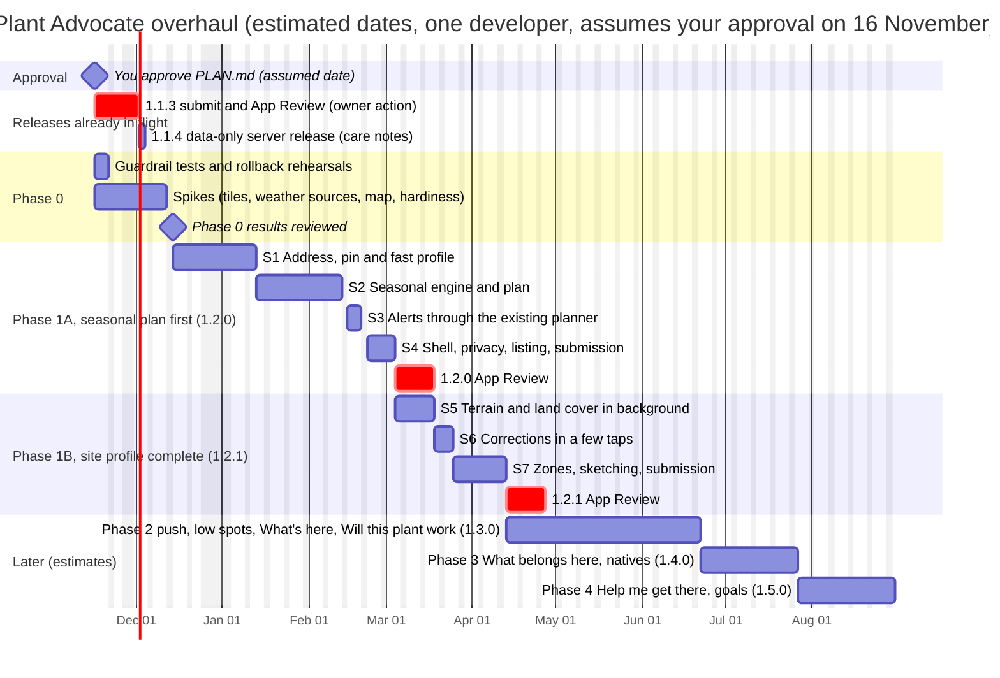

# PLAN.md — Plant Advocate: from plant care app to land stewardship app

**Status: Owner answers received 2026-11-14 (15 of 18, relayed by Duet) and a direct go-ahead to act on them on 2026-11-15. Where an answer changes this plan, `docs/design/2026-11-15-overhaul-build-spec.md` wins. See "Owner answers" in section 13.**

Until you approve this plan, nothing is merged to the main branch and nothing on the live server changes. Phase 0 starts on your approval. The dates below assume that is 16 November 2026 and move day for day with it.

Date: 2026-11-13. Companion document: [AUDIT.md](./AUDIT.md) (what exists today, with a keep, refactor, delete or defer verdict for each component, and the open questions in its section 8).
Repository: `/Users/allisonbowman/Developer/Garden-Gnome`, `origin/master` at `26525f9`, app version 1.1.3 (`mobile/app.json:5`).

Conventions used here:

- Effort figures are **estimates** for one developer, in working weeks. Dates are estimates built from them.
- `path:line` references were checked against the repository on 2026-11-13 unless marked "per the audit".
- "Flag" means a server setting that makes a route answer 404 and stops any outside service being called.
- Labels: **P0-n** are Phase 0 spikes and guardrails (section 3); **S1 to S7** are Phase 1 slices (section 4); **Dn** are key decisions (section 2); **"decision n"** is an owner decision (section 13).
- "Your approval" always means your approval of this plan. Apple's decision is written "Apple's approval" or "App Review approval".
- Short forms used after first mention: App Review (Apple's review of an App Store build); TestFlight (Apple's tester distribution); pull request (a reviewed change to the repository).

**Terms**

| Term | Meaning |
|---|---|
| Spike | A time-boxed test that answers one question before work depends on the answer. |
| Guardrail | An automated test that fails if a later change breaks the app already in the App Store. |
| Migration | A change to the structure of the database. |
| Master | The main branch of the repository. Every change to it goes straight to the live server. |
| Smoke check | A short scripted check that the live server answers correctly after a restart. |
| Volume snapshot | A point-in-time copy of the live database disk. |
| Tile mode | Asking a public service about a fixed square of land instead of an exact point. |
| Raster | Map data stored as a grid of cells. |
| Provenance | Where a value came from: a public map, a calculation, a default, or you. |

---

## 1. Summary

### The plan in five sentences

1. Plant Advocate becomes site-first, and deliberately not a plant identification app: you add a **Property**, which starts as one whole-lot **Zone**, on top of today's growing areas, so the app already in the App Store keeps working and every database change only adds something.
2. A property's **site profile** is read from free United States public data (soil survey, elevation, land cover, hardiness zone, frost normals), sent to those services only as a grid-snapped area a few hundred metres across, cached per property, and shown with an earned confidence label, a reason, a source and a one-tap correction where a correction makes sense.
3. The **seasonal care plan ships first, as version 1.2.0**: weather-triggered events (frost, freeze, dormancy, leaf drop, and the spring events a late-winter release needs), each with low-impact guidance and a "why and data source" line, plus optional on-device alerts. Terrain, corrections and zone sketching complete Phase 1 in version 1.2.1 about six weeks later (decision 27).
4. Work is built in **small pieces that stay switched off on the live server**, with guardrail tests first, and **no overhaul database change goes live until Apple approves 1.1.3**, because every change to the main branch goes straight to the live server and a database change cannot be undone by rolling the code back.
5. The four entry modes, native-first ranking, goals, server push and the computed "where water collects" reading follow in later releases; landscaper connection and automated care recommendations stay dormant and unbuilt; everything through the four modes runs at zero data cost.

### Timeline (estimates)

Bars are working days. Weekends, Thanksgiving (26 and 27 November) and 24 December to 1 January are excluded. The App Review bars assume up to two weeks each; Apple's actual time is outside the plan's control.

| Phase | Working weeks (estimate) | Calendar (estimate) | Ships to owners |
|---|---|---|---|
| 0. Spikes and guardrails | 3.5 | 16 Nov to 11 Dec 2026 | Nothing new. 1.1.3 as uploaded, once Apple approves it. |
| 1A. Address, pin, fast profile, seasonal plan, alerts (S1 to S4) | 10 (range 9 to 11.5) | 14 Dec 2026 to about 3 Mar 2027 | Version 1.2.0, mid-March 2027 (range early March to early April) |
| 1B. Terrain, land cover, corrections, zones and sketching (S5 to S7) | 5.5 (range 4.5 to 6.5) | 4 Mar to about 12 Apr 2027 | Version 1.2.1, late April 2027 (range mid-April to mid-May). This completes the Phase 1 definition of done. |
| 2. Alerts by server push, low spots, "What's here?", "Will this plant work?", Walk the garden under zones | 10 | April to June 2027 | 1.3.0 |
| 3. "What belongs here?", natives first | 5 | June to July 2027 | 1.4.0 |
| 4. "Help me get there" (goals) | 5 | July to August 2027 | 1.5.0 |
| 5. Paid-tier boundary, licence clean-up, deletions | 2 to 3 | Only on your approval | Depends |

### What ships to owners, and when

| When (estimate) | What an owner gets |
|---|---|
| When Apple approves 1.1.3 | Today's plant care app, unchanged. |
| Same week | 1.1.4: improved care notes, delivered by the server with no new download. |
| Mid-March 2027 | 1.2.0: enter an address, confirm the pin, see a first site profile (hardiness zone, typical frost dates, soil from the area soil map), say what is on the lot, and get a weather-driven seasonal plan with optional alerts. Fall 2026 events appear as **happened** or **typically around**. |
| Late April 2027 | 1.2.1: slope, facing direction and neighbourhood land cover; fix sun and soil in a few taps; sketch zones. |
| Early summer 2027 | 1.3.0: frost alerts that arrive even when the app has not been opened, low-spot readings where a detailed ground survey exists, and the first two entry modes. |
| Summer and early autumn 2027 | 1.4.0 and 1.5.0: native-first suggestions, then goals with measurable targets. |

**Honest note on the date.** Earlier discussion assumed a January release, and an earlier draft of this plan said ten weeks for all of Phase 1. That figure was the engineering judge's budget for a smaller draft (fall events only, no observed status). With spring events, the observed status, the pin flow, lot contents and land cover added, all of Phase 1 is about 15.5 working weeks (range 13.5 to 17.5) after Phase 0. Built as one release it would be submitted about 8 April and reach owners in late April, after most of the seasons it models. So the plan builds the seasonal engine second instead of fourth and ships it first. Even so, mid-March is late for the South: the Washington test point still has the late-frost watch, spring cleanup and "tender plants back out" ahead, while the Austin test point has little ahead until fall. Section 12 lists what could be cut to bring 1.2.0 forward by one to two weeks. Decision 27 asks you to confirm the two-release split.

---

## 2. Key decisions

Where the five drafts or the three judges disagreed, the row says so and gives the reason for the choice.

| # | Decision | Choice | Why | Rejected alternative |
|---|---|---|---|---|
| D1 | What a Zone is | A Zone is a `GrowingArea` row (`models.py:596`) with new nullable columns, grouped under a new `property` table. | Plants, weather, fit, census and account deletion all key on the growing area. The 1.1.3 client sees zones as ordinary growing areas, so a plant filed under a zone never disappears from the old app. All five drafts agree. | A separate zone table (forks plants, fit and census; hides zone plants from 1.1.3). |
| D2 | "Species optional" | Met by `vegetation_type` on the zone. `Plant.species_id` stays required (`models.py:646`). No phase relaxes it. | Relaxing it needs a rebuild of the `plant` table on a database where structure changes are not transactional. This follows AUDIT.md sections 3.2 and 4.2: an unidentified shrub is recorded as a zone's vegetation type, not as a plant (decision 28). | Species-less plant rows such as "a group of shrubs" (cost-data-realism draft). |
| D3 | How schema changes land | Additive only. One migration per pull request, one concern each, each written to be safely re-run. Plain `ADD COLUMN` on `growingarea`; `property_id` is an indexed integer with **no** database foreign key. Every migration has a tested downgrade. The deploy job snapshots the volume before any push that carries a migration (P0-14). Rollback rule: boot runs an unconditional upgrade to the newest revision (`garden-gnome/app/db/database.py:108`), so an older image is expected not to start against a newer database; P0-2 measures this and fixes one rule here, recommended a small boot change that skips the upgrade when the database is ahead of the image. | A real foreign key forces a rebuild of `growingarea`, the hazard migration 0017 documents. Foreign keys are not enforced in this database anyway (per the audit). | A foreign-key column (mvp-seasonal, owner-effort); five tables in one migration (cost-data-realism). |
| D4 | When schema changes may land | No migration and no route change on master until App Review approves 1.1.3. A one-time workflow change right after your approval (decision 3) stops pushes that touch only documents, site pages and tests from deploying; after it, guardrail tests and documents may merge at any time. One exception: if P0-0 finds production behind master, current master is deployed once under a snapshot before 1.1.3 is submitted, which applies master's existing migrations up to 0022; no overhaul migration is involved. | Every master push redeploys, docs and tests included: the workflow trigger has no path filter (`.github/workflows/ci.yml:14-17`; deploy job gated only on the branch at `:72`; `flyctl deploy` at `:100`) and the container re-runs seed and migrations at every boot (`garden-gnome/Dockerfile:29`). A test-only merge restarts the live server during review exactly as a document would, so the two are treated alike. | Landing backend work during review because "nothing calls it" (engine-architecture). Treating test-only merges as harmless (an earlier draft of this plan). |
| D5 | Dark launch | Flags `SITE_PROFILE_ENABLED`, `SEASON_PLAN_ENABLED` and a `GEODATA_PROVIDERS` allowlist, plus per-account allowlists (`SITE_PROFILE_ALLOWLIST`, `SEASON_PLAN_ALLOWLIST`) holding your own test accounts for rehearsal on production. Off means: new routes answer 404, new optional fields on the existing growing-area routes are not persisted, no provider client is constructed. | Owner-effort left write routes live with the flag off; engine-architecture had no flag. A 404 is the only state that is truly dark. | Flag that only suppresses outbound calls. |
| D6 | When flags turn on | **Before** 1.2.0 is submitted, after the privacy page is live and the App Privacy answers are saved. Off again if rejected. A flag flip restarts the machine, so it gets the same smoke check as a deploy. Before that day the features have already run on production for the allowlisted accounts for at least two weeks. | The reviewer uses production. Cost-data-realism turned flags on after approval, so the reviewer would have met 404s. | Flip after approval. |
| D7 | What the federal services are told | A grid-snapped area built from cells about **250 metres** across; the lot is sampled on our server. The set of cells requested must depend only on the grid, never on where the lot sits inside a cell (for example, always the fixed 2 by 2 block of cells whose shared corner is nearest the pin, about 500 metres across). Weather keeps today's rounding to about a kilometre. | Product and data judges both chose 250 m: a 1 km tile forces 10 m elevation and throws away the 1 m ground survey found at both test points; the exact point hands a house location to new recipients. A lot near a cell edge would otherwise need neighbouring cells, and fetching only those would show which edge the property is on. **Unproven**: the spike only tested point queries and a small elevation window, so Phase 0 must prove tile mode and choose the block rule (P0-3). | 1 km tile (release-safety); point at about 11 m (owner-effort and the site-profile science draft, which assumed a point was required). |
| D8 | Where the stored location comes from | The owner confirms a **pin** on the satellite view; the pin is what is stored. The phone's geocoder only centres the map. City, state and time zone are filled on our server from public data (the National Weather Service lookup for the pin), never from the phone's geocoder. The map module is therefore needed in S1, the first slice. | The maps research reads Apple's terms (Attachment 6, sections 2.2 and 2.5) as barring storage of geocoder output in a derived database; that covers place names as much as coordinates. A confirmed pin is also more accurate for lot-scale lookups. Costs one tap. | Storing geocoder output (what 1.1.3 does today for coordinates, city and region; see decision 6). |
| D9 | Existing users' coordinates | Never sent to the new services until the owner taps "Read the land here?" for that growing area. No backfill of properties. | Those coordinates were collected under a policy that named only weather providers (`site/privacy.html:140`). | Automatic backfill. |
| D10 | Stored weather history | Nothing stored or accumulated from Apple WeatherKit beyond a short-lived forecast cache. Observed temperatures and degree days come from open government data chosen in spike P0-5. No WeatherKit data in test fixtures. | The weather research reads Apple's terms (Attachment 8, sections 1.5 and 1.6) as barring a stored daily series or derived database. All three judges marked this must-fix. It removes the weather-history design in two drafts. | A `weather_day` table filled from WeatherKit (mvp-seasonal, engine-architecture). |
| D11 | Forecast source | For United States properties the engine reads the National Weather Service (public domain per research, 7 days, includes overnight wind and sky cover) and, when it is enabled and within quota, Apple WeatherKit as a second opinion. Agreement between the two raises confidence. Open-Meteo is never called for United States coordinates from 1.2.0 on, on new routes or on the existing weather route (decision 17). | WeatherKit was answering NOT_ENABLED as of July 2026 (`docs/2026-07-30-weatherkit-401-closed.md`), so the plan cannot depend on it. Live checks found two providers 10 °F apart for the same night; agreement is the best confidence signal available. Open-Meteo's free tier is non-commercial. **Departs from the brief** (WeatherKit as the source; decision 8). | WeatherKit only (the brief's wording; kept as the goal, P0-6). |
| D12 | Dormancy and leaf drop | **Not** predicted by growing degree days. Fall hardening is timed from day length and local freeze normals; die-back is an observed killing freeze; leaf drop is a labelled **window** corrected by one owner tap; woody dormancy is a state reached after leaf drop plus cold. Spring emergence uses the USA National Phenology Network Spring Index, a validated heat-accumulation model; a direct degree-day threshold waits for 1.3.0 with a winter-chill condition. | The seasonal science design overrides the brief here on evidence: autumn timing models miss by 10 to 14 days and often do no better than the long-term average. Saying so is more useful than a false date. **Departs from the brief** (decision 18). | A degree-day leaf-drop date. |
| D13 | Calendar realism | Phase 1 includes spring events and an **observed** status. A late-winter install shows fall events as happened (from observed data) or "typically around", never as a ten-month wait. | mvp-seasonal's point, endorsed by the product and engineering judges. | Fall-only Phase 1 (release-safety). |
| D14 | Sun | The category (full sun, part shade, shade) is **unknown** until the owner taps. Terrain gives an "open sky" figure and a warmer/cooler note only. The question shows three choices with none pre-selected. | Live computation: every slope and facing gives 12.3 to 12.6 open-sky hours; a tree line cuts it to 2 to 8 hours. Terrain never sets the category on a suburban lot. A pre-selected answer from 30 m tree cover would become "You told us" on one confirming tap; Zilker Park reads 0% canopy. **Departs from the brief** (sun computed from slope and facing; decision 21). | "Low confidence full sun" from slope and aspect (three drafts); using 30 m tree canopy to set or pre-select a value. |
| D15 | "Where water collects" | Phase 1 asks the owner ("After a heavy rain, does water sit?") and shows the soil survey's flooding note. The computed low-spot reading comes in Phase 2 and only where the ground survey is 3 m or finer. **Deferred from the brief's Phase 1 list; needs owner agreement (decision 9).** | At 10 m a lot is 10 to 20 pixels and detections vanish; even at 1 m, road embankments make false ponds without building masks. Engineering judge asked for it off the critical path. | A water estimate on 10 m data (three drafts). |
| D16 | Land cover | In Phase 1 (slice S5, version 1.2.1) as "Neighbourhood context" only, never used to tag a zone or set sun. It also feeds the disturbed-soil cross-check. | The brief lists it; two of three judges keep it; the spike found it fast (200 to 360 ms) and reachable now, though it did not answer in an earlier session, the newest layer is published under a temporary "-wmstest" name and coverage is the contiguous states only (P0-3 and P0-4 must confirm a stable endpoint); the cross-check was the most useful confidence signal. It is the second item to slip if time runs short. | Deferring it (mvp-seasonal, engineering judge's default). |
| D17 | Confidence | Four internal levels (high, medium, low, unknown) with provenance stored separately, enforced by tested per-dataset rules. Shown in plain words: "You told us", "Good estimate", "Area estimate", "Rough estimate", "Not known yet", plus "Neighbourhood context" for land cover. | Science design supplies the levels and caps; cost-data-realism supplies plain words and "rules as tests". "Area estimate" is new wording for medium: a source that describes the surroundings well. | Bare High/Medium/Low; one numeric score. |
| D18 | Vegetation types | The brief's five: tree, shrub, grass, garden bed, bare or hardscape. Potted plants are a lot-level answer and a plant attribute, not a sixth zone type. | Two drafts added a sixth type without asking. | `potted` or `containers` as a zone type. |
| D19 | No-sketch owners | One skippable chip screen, "What's on your lot?", stored on the property, built in S1. Skip assumes a mixed yard. It is an extra question the brief did not ask for (decision 25). | It is what lets the default whole-lot zone produce leaf-drop and dormancy tasks with no sketch and no species. | Leaf drop only for sketched tree zones (engine-architecture). |
| D20 | Enums the old client reads | Frozen. New ideas go in new columns; new goals live on the property; new fit axes go on new endpoints. | Corrected reason: an unknown value is shown blank (`GrowingAreasScreen.tsx:40`) or left out of the goal chips (`GrowingAreaDetailScreen.tsx:291`). It does not crash, as one draft claimed. The old client never sends goals or surface on edit (its only PATCH, `GrowingAreaDetailScreen.tsx:145-152`, carries location fields), so stored values survive. | Adding members to `GrowingSurface` or `GrowingGoal` (`models.py:109,127`). |
| D21 | Alerts in 1.2.0 | On-device only, scheduled through the one existing planner, each showing the forecast time it was built from. Server push in 1.3.0 as its own privacy change. | `reminders.ts` cancels every scheduled notification on each reschedule (`mobile/src/notifications/reminders.ts:156,169,202`), so a separate scheduler would be wiped. Push is free to run but stores a device token, which today's privacy answers say the app does not hold. The seasonal science design prefers push; all three judges defer it one release. | Server push in Phase 1; a separate `seasonal.ts` scheduler. |
| D22 | Front door | Five tabs: **Seasons, My land, Plants, Species, Settings**. Census moves into Settings. No screen is deleted and no route name changes. The app opens on Seasons once a property exists; an existing account with plants and no property still opens on Plants, with an invitation card. | Product judge: the front door must stop being plants-first. Engineering judge: keep the regression surface small. This is one new tab (Seasons), one relabel (Growing areas to My land), one move (Census into Settings) and a reorder. AUDIT.md marks the Census tab "delete"; this plan moves it instead, to keep the 1.2.0 change small. | Yard hidden inside the Growing areas tab (release-safety); six tabs (cost-data-realism). |
| D23 | Calendar gates for per-plant care | Indoor plants keep the month gates (feeding rest November to February, February repot check; `mobile/src/notifications/plan.ts:30,62`). For outdoor plants on a property, feeding checks and the advisor's feeding lines stop at the property's fall hardening event (or 31 August where it is unknown) from 1.2.0. The remaining outdoor gates move to weather triggers in 1.3.0. The listing sentence at `docs/app-store/listing.md:115` is edited in 1.2.0. | Today's gate allows feeding reminders through October (`plan.ts:30`; the server advisor mirrors it at `garden-gnome/app/services/advisor.py:370`), while the new plan tells the same owner to skip fall fertilizer. AUDIT.md asks for feeding checks to be switched off or season-gated in Phase 1 for this reason. | Keeping every gate until 1.3.0 because the listing promises them (an earlier draft; the listing is rewritten in 1.2.0 anyway). Replacing every calendar rule in Phase 1. |
| D24 | `candidate-categorization-proposal` | If the owner accepts its design record by the end of Phase 0, merge it right after 1.1.4 so the overhaul's first migration is 0024, after `0023_eaten_parts`. Otherwise park it, and the overhaul's first migration is 0023. A single-head test enforces whichever is chosen. | The judges split. The engineering reasoning wins: the branch edits `fit.py`, `growing_areas.py` and `realEstate.ts`, the same files Phase 1 touches, and two migration heads stop the boot. | Parking until Phase 3 by default (product judge). |
| D25 | Reason and source | One "explained" output shape (value, reason, sources, confidence, provenance) for site values and seasonal events, with a test that walks every response and fails on a missing reason or source. | Turns a constraint from the brief into a gate, without adopting engine-architecture's whole new package up front. | Review by eye. |
| D26 | Dependencies | `numpy` only, pinned on the branch that first imports it (after Apple's approval of 1.1.3, because a pin changes the production image), proven on the Python 3.12 image and measured on the 512 MB machine. Elevation is read as raw 32-bit values, not as an image file. | The spike found the image format returns a padded tile; the raw format parsed cleanly. Fewer native libraries protects a small machine. One open point: the Phenology Network publishes its national rasters as GeoTIFF; if P0-5 finds no raw or text grid format, a pinned pure-Python reader is added off the request path and this row is amended. | `tifffile`, `shapely` or the GDAL geospatial library. |
| D27 | Releases | 1.1.4 is server and data only. The overhaul is binaries 1.2.0 and 1.2.1 (D28). | `care-notes-1.1.4` changes catalog data only. Two drafts added an unnecessary review cycle. | A 1.1.4 binary. |
| D28 | One release or two for Phase 1 | Two. **1.2.0** = S1 to S4 (address, pin, fast profile, lot contents, seasonal plan, alerts). **1.2.1** = S5 to S7 (terrain, land cover, corrections, zones and sketching), which completes the brief's Phase 1 definition of done. | The seasonal engine needs no terrain, land cover or sketch. One release would reach owners in late April, after the seasons it models. The brief says the seasonal engine ships first. Cost: a second App Review and a second privacy update. | One release in late April with spring cleanup and "tender plants back out" cut to 1.3.0 (offered in decision 27). |

---

## 3. Phase 0 — spikes and guardrails (before any product code)

**Goal:** make every later master push safe, and replace the plan's remaining assumptions with measurements. About 17.5 working days of effort (estimate), about 3.5 weeks for one developer. Only the week of unattended logging in P0-5 overlaps other work.

**Rules for Phase 0**

- Phase 0 starts on your approval of this plan (decision 2). Nothing is merged before it.
- The first merge of any kind waits for P0-0, because every merge deploys until the workflow change in P0-14 is in.
- After P0-14, pull requests that touch only tests, documents or site pages may merge to master; they no longer deploy. If you answer no to decision 3, guardrail tests and documents both wait on a branch and merge as one push after Apple approves 1.1.3.
- No production data leaves the Fly volume. Test databases are synthetic.
- Live calls use **public landmarks only** and never a user's address. They run from a laptop, except P0-3b, which runs from a one-off Fly machine that is destroyed afterwards.
- Outbound requests send a generic descriptive User-Agent and at most 2 to 4 at a time per service.

| # | Spike or guardrail | Time box | Decision rule |
|---|---|---|---|
| P0-0 | **Production state**: record which commit and migration revision production runs (`flyctl ssh console`, `alembic current`) and whether the deploy secret exists. The audit found on 2026-11-13 that the live server publishes master's 34 public paths including `/growing-areas`, so a master-era build is live; its exact commit and revision are not visible from outside. | 0.25 day | If production is at migration 0022: proceed. If it is behind: take a volume snapshot, deploy current master once, smoke-check `/growing-areas`, all **before** 1.1.3 is submitted (decision 0). Also record whether the live `site/privacy.html` is the 2026-10-20 version the app links as binding (on 2026-10-31 the live site still served the 2026-10-16 pages, AUDIT.md section 2.4); if not, publish it before 1.1.3 is submitted. |
| P0-1 | **Guardrail tests** (test-only): a replay of the 1.1.3 client built from requests and responses captured from the actual 1.1.3 build (it calls `/growing-areas` and `POST /auth/logout`); an enum freeze; a single-migration-head check; an upgrade test from a synthetic database built by running migrations 0001 to 0022 and the seed, then loading invented rows that mirror production shapes (the automatic "My Home" area, null surfaces, legacy rows); scaffolds for the privacy-recipient test and the acronym scan. | 2.5 days | All green on master before any schema pull request is opened. Note: `garden-gnome/tests/test_legacy_client_fields.py` replays the older 1.1.2 build on `/environments`; it stays, and the new replay is added beside it. |
| P0-2 | **Rollback rehearsals**, all on Fly with scratch volumes that are destroyed afterwards. (a) Take a volume snapshot, restore it to a scratch volume, boot the previous image against it. (b) Boot the previous image against a copy of the database stamped one revision ahead and record what happens: boot runs `command.upgrade(cfg, "head")` unconditionally (`garden-gnome/app/db/database.py:108`), so an older image is expected to fail to start (standard Alembic behaviour, not yet run here). (c) Check what an older image's seed and claim sync do to catalog rows written by a newer one. | 1 day | No migration merges until one restore has worked end to end. From (b), write one rule into D3: either a small boot change, merged after Apple approves 1.1.3 and before the overhaul's first migration (0024, or 0023 if the branch is parked), that logs and skips the upgrade when the database is ahead of the image, so additive migrations stay safe to roll back by image; or "forward-fix only", with the restore runbook stating how many minutes of owner writes a restore loses. Recommended: the boot change. |
| P0-3 | **Tile-mode fetch** (not proven by the spike): soil map polygons with geometry for the snapped area; land cover for the area as an image or coverage; elevation for the area at 1 m, requested in a metric projection with a plain GET request in the raw format, with full-length checks, up to 3 retries and a 30 second timeout. Ten public landmarks, three attempts each, using the production HTTP client library (the science run saw Python's built-in client drop connections to the elevation host where curl worked). Also decides the block rule in D7: fixed 2 by 2 block of 250 m cells, or a single cell with a fixed padding rule; payload and storage are re-measured for the larger block. **P0-3b:** repeat the fetches from a one-off Fly machine in the production region, so reachability from Fly's network address is measured before S1. | 2.5 days | Adopt tile mode for a source if at least 95% of fetches succeed within the retry budget from both the laptop and Fly, the answers match the point-query values at the two verified test points, and the compressed payload is under 150 KB (re-set if the 2 by 2 block is chosen). **Fallbacks, in order:** a fixed lattice of points inside the snapped area (the request pattern depends on the area, not the lot); a smaller snapped window; and only if both fail, an owner decision between exact-point lookups with explicit opt-in and dropping that source. A source that Fly cannot reach is treated as failed. |
| P0-4 | **Coverage and licence table**: the same ten landmarks include Alaska, Hawaii, Puerto Rico and one address outside the United States. One row per source: licence, required attribution, coverage, quota, version. Confirms the National Weather Service public-domain wording (research did not re-read it) and a stable land cover endpoint. | 1 day | A source with no coverage for a region yields "Not known yet" there, never a default. Launch scope is the contiguous United States unless every source answers elsewhere. |
| P0-5 | **Observed temperatures, degree days and the Spring Index**: read the Applied Climate Information System (ACIS) terms and test its reliability for a week; compare with USA National Phenology Network daily national rasters (sampled on our server, so no location is sent) and National Oceanic and Atmospheric Administration (NOAA) station records fetched by station identifier. Fetch one day of each needed Phenology Network layer with the production HTTP client and record format, bytes, parse time and peak memory. Any ACIS point query uses the weather cell (about 1 kilometre), never the pin. | 2 days plus a week of unattended logging | If ACIS terms allow use in an app that may later have a paid tier, and it answers at least 99% of calls: ACIS for daily lows, the cold sum and rain; the Phenology Network for the Spring Index. If terms are silent or restrictive: Phenology Network rasters plus NOAA station records, with these stated limits: the science run found the Network's daily-low layer reading 49.9 °F against 40 °F on one night, so it is not used to confirm frost; station records lagged 3 days at airports and 6 weeks at the Arboretum station; so "happened" then comes only from owner taps and from station records after their lag, the next-morning check becomes the question "Did you get frost?", and fall events for a late install read "typically around". Raster reader: a raw or text grid format if offered; if only GeoTIFF is offered, convert in a scheduled step off the request path with a pinned pure-Python reader and amend D26. Never WeatherKit. One source per threshold family, because two official sources differed by 15% at the same point. |
| P0-6 | **WeatherKit availability and terms**: fix or explain NOT_ENABLED in the developer account; confirm how calls are counted; you read Attachment 8 sections 1.3, 1.5, 1.6 and 2.2. | 1 day plus your reading | If still not enabled at the end of Phase 0: the engine ships on the National Weather Service for United States properties, and all copy names the provider that actually answered. Frost confidence is capped at "Area estimate" in any case (section 7). Until you give a legal reading, event records store the temperature band and provider name, not a series. |
| P0-7 | **Hardiness grid**: download the official 2023 rasters, confirm how values are encoded, convert to a compact grid file, check the two test points read 8a and 9a, read both licence statements and the exact attribution wording. | 1 day | If encoding or licence is unclear: fall back to the published ZIP Code table, sampled on our server by the nearest ZIP centroid to the weather cell, labelled "Area estimate". No postal code is sent or stored. (The phone's raw geocode result carries `postalCode`, `GeocodedAddress` at `mobile/src/location/geocode.ts:7,15`, but `ResolvedPlace` at `:21-28` does not, and forwarding it would be geocoder output again, which D8 avoids.) |
| P0-8 | **Leaf-drop calibration and this fall's fixtures** — start in week 1, because the season is ending. Record daily highs and lows since 1 July from the open source for three climates; pull volunteer "leaves falling" observations and the satellite dormancy dates offline; compare with the window formula. | 1.5 days | If the formula window contains the observed median at 2 of 3 sites: ship it, labelled an estimate. If not: ship the simpler window anchored on freeze normals with wider bounds. In both cases it is a window with an owner tap, never a date. |
| P0-9 | **Map pin and sketch**: `react-native-maps` (the version Expo's software kit 57 pins) on React Native 0.86 on a physical iPhone: satellite view, draggable pin, polygon drawing, Apple's legal label visible, privacy manifest checked. **This gates S1**, because the confirmed pin is the stored location (D8). | 1.5 days | Pass: use it. Fail: a small local module that takes a satellite snapshot with a draggable marker (pin) and tap-to-outline (sketch). If the sketch part fails: ship "Add a zone without drawing" only, which needs your sign-off that it meets "sketch zones" (decision 14). If no map of any kind works for the pin: the choice returns to you (decision 14) between holding the release and a last resort in which our server looks the typed address up with the United States Census Bureau geocoder (public domain) and the owner nudges the result on a plain grid. The last resort sends the address through our server, unstored, and adds a named recipient to the privacy policy. |
| P0-10 | **Memory and dependency gate**: on a branch, build with pinned `numpy` on the Python 3.12 slim image (`ci.yml:44`); re-run the backend suite on 3.12 (the recorded baseline ran on 3.14.7); measure peak memory for a terrain job over the chosen block while the boot-time catalog sync runs; measure request latency for `/species` and `/growing-areas` while a terrain job runs. | 0.5 day | Peak under 350 MB on the 512 MB machine (`garden-gnome/fly.toml:30`) and no request slower than twice its idle time, or the window shrinks or the maths moves to plain Python. The pin itself reaches master only with the first code that imports it (D26). |
| P0-11 | **Deploy facts**: reconcile `fly.toml:22` (`min_machines_running = 1`) with the four notes that say 0 (`ci.yml:104`, `docs/deploys.md:63`, `docs/app-store/README.md:67`, `docs/app-store/review-notes.md:162`; AUDIT.md section 2.3); record which is true in production. Record the commit the uploaded 1.1.3 build was made from (from the build service's record; likely `26525f9`) and tag it `v1.1.3`. The repository has no tags today. | 0.25 day | Any later background work is written to survive a restart either way. |
| P0-12 | **Citations**: attach a primary page to each guidance line that lacks one: fall pruning, wet soil, the 8 to 24 inch stem figure, oak pruning windows, watering new plantings and evergreens (the science file cites University of Minnesota Extension from memory), mowed leaves on the lawn (Michigan State material was not read in full), skipping fall fertilizer (name the specific pages for and against), and "cloth, not plastic" frost covers (the cited freeze classes say nothing about covers). | 1 day | A line without a primary citation ships worded as general advice with "sources differ", or is cut. |
| P0-13 | **Drafts**: design records 0012 (seasonal tasks are cited; weather events are not calendar checks), 0013 (public geodata is an estimate fetched by snapped area), 0014 (a Zone is a growing area), 0015 (confidence rules, including the Arboretum soil correction in section 6); draft privacy, listing and consent text. | 1 day | Reviewed with this plan. |
| P0-14 | **Workflow change** (decision 3), one pull request, merged before 1.1.3 is submitted: the deploy job is skipped when a push touches only `docs/`, `site/`, `*.md`, `garden-gnome/tests/` and mobile test files; and when a push touches `alembic/versions/`, the deploy job first runs `fly volumes snapshots create`, waits for it, and fails the deploy if the snapshot fails. | 0.5 day | This merge deploys once (a restart, no migration). After it, snapshots before migrations are automatic, not a remembered step. |

**Phase 0 exit:** guardrails green; restores rehearsed and the rollback rule written into D3; a written result for each spike with its rule applied; the owner decisions in section 13 answered, or defaulted where a default is allowed. You review the results before S1 starts.

**If Apple's approval of 1.1.3 is slow:** route-free work (the seasonal engine and its tests, the terrain maths, the copy tables) proceeds on a branch. Only migrations and routes wait.

---

## 4. Phase 1 — vertical slices (versions 1.2.0 and 1.2.1)

**Definition of done (from the brief):** enter an address → default site profile from public data → adjust sun and soil in a few taps → sketch zones → weather-driven seasonal plan with at least frost, dormancy and leaf-drop events.

Version 1.2.0 (S1 to S4) delivers the first, part of the second and the last step. Version 1.2.1 (S5 to S7) delivers the rest. Phase 1 is done when 1.2.1 ships (D28, decision 27).

**How slices work**

- Each slice is a thin path from database to screen, merged in small pull requests. Backend parts deploy dark behind the flags. Mobile parts merge behind a `GET /features` check, so entry points stay hidden while flags are off.
- Each flag has an account allowlist (`SITE_PROFILE_ALLOWLIST`, `SEASON_PLAN_ALLOWLIST`: your own test accounts). While a flag is off, routes answer 404 for everyone else.
- Each slice is first demonstrated on the simulator against a local backend with recorded fixtures. From the end of S1, each slice's acceptance is then repeated **on production**, through TestFlight, with the allowlisted accounts and public landmarks only. This is the only way to learn how the real 512 MB machine and Fly's network address behave against the federal services before App Review does. TestFlight builds go to your own internal-tester accounts only.
- Every push that carries a migration is preceded by an automatic volume snapshot (P0-14) and followed by the smoke check. Every migration has a tested downgrade.
- Migration numbers below assume `0023_eaten_parts` is merged first (D24). If it is parked, each number shifts down by one.
- Holidays: the estimates assume no work on 26 and 27 November or from 24 December to 1 January.

### S1 — Address, pin and fast profile (3 weeks, estimate)

| | |
|---|---|
| Scope | Address or "Use my location" → satellite view with a pin → owner drags and confirms → property and whole-lot zone created → first profile within a few seconds: hardiness zone, typical frost dates, soil. "What's on your lot?" chips (skippable). "Reading your land" screen ticks each source as it arrives; a source that fails says "Couldn't reach it. We'll try again." and never blocks. The old-client rules for zones (section 5) land here, because zones exist from this slice. |
| Backend files (new) | `app/routers/properties.py` (`POST`, `GET`, `PATCH`, `DELETE /properties`, `GET /properties/{id}/site-profile`); `app/routers/features.py` (`GET /features`); `app/services/geodata/{tiles,soil,hardiness,normals,places}.py` (`places` fills city, state and time zone from the National Weather Service lookup); `app/services/site/{profile,confidence,explained}.py`; `app/data/geo/` (hardiness grid, freeze normals, station list, each with a licence note). |
| Backend files (edited) | `app/config.py` (flags and allowlists); `app/main.py` (mount); `app/routers/growing_areas.py` (old-client rules); account deletion in the `DELETE /me` handler. |
| Mobile files | New `src/screens/{AddressPinScreen,ReadingLandScreen,SiteProfileScreen,LotContentsScreen}.tsx`, `src/property/api.ts`, `src/siteProfile/rows.ts`, `src/copy/plainWords.ts`; types in `src/types/index.ts`. Reuses `src/components/AddressPicker.tsx` and `src/location/lookup.ts`. New dependency `react-native-maps` (or the P0-9 fallback), with its privacy manifest entry. |
| Migrations | `0024_property`, `0025_growingarea_zone_columns`, `0026_site_reading` (one pull request each). |
| Flags | `SITE_PROFILE_ENABLED`, `SITE_PROFILE_ALLOWLIST`, `GEODATA_PROVIDERS=soil`. |
| Tests | Migration tests including a half-applied case, a working downgrade, and "growingarea was not rebuilt; plant and stewardshiprecord still reference it"; flag off gives 404 and constructs no client; an allowlisted account passes while others get 404; whole-lot zone has `surface = null`, `temp_exposure = outdoor`, `shelter = exposed` (`test_zone_defaults_are_outdoor_exposed`); the whole-lot footprint is the labelled default square; stored coordinates come from the confirmed pin; the property route accepts no city, region, country or time zone from the client; the soil query builder accepts only validated numbers; the two test-point fixtures give the verified values (Arboretum: well drained fine sandy loam, "Rough estimate", reason codes `near_mapunit_boundary_17m` and `neighbour_differs`; Zilker: disturbed flag, every soil value "Rough estimate", flooding note read from the month rows); a rule test that a point within 30 m of a map line with a differing neighbour is never above "Rough estimate"; hardiness "on the line between" case; outbound requests are snapped and the set of cells requested is the same for any pin in the same block (`test_geodata_requests_are_snapped`); old-client rules (`test_old_client_cannot_relocate_zone`, `test_old_client_post_never_gets_property`, delete of a whole-lot zone answers 409, sun edit on the old route records an override); with the flag off the new optional fields on `/growing-areas` are not persisted; account deletion removes the property; 1.1.3 replay green with a zone present, including its weather card and candidate list behaving as an outdoor area; a source scan fails if any touchable or map control in the new screens lacks `accessibilityLabel` (AUDIT.md section 4.1). |

### S2 — Seasonal engine and plan (4.5 weeks, estimate)

| | |
|---|---|
| Scope | A pure engine that turns forecast, observed lows, normals, day length, the Spring Index, lot contents, zones and plants into events with a status (typical, forecast, happened, you confirmed, not needed this year). The Seasons screen: a "Next up" card, then a timeline; each event shows why, data, guidance and which zones. Owner taps: "Did you get frost?", "Leaves are falling", "Leaves are mostly down", "Done", "Not needed". The "My yard frosts earlier / later than the neighbours" setting. Feeding checks and advisor lines for plants on a property follow the seasonal engine (D23, section 7). |
| Backend files | New `app/services/season/{engine,frost,phases,daylength,rules}.py`, `app/services/climate/{observed,normals,spring_index}.py`, `app/data/season_rules.json`, `app/routers/season.py` (`GET /properties/{id}/season-plan`, `POST …/season-plan/{event_key}`). Edited `app/services/weather.py`: a new planning fetch (7 days, overnight wind and sky cover), a persistent per-cell cache, and no Open-Meteo call for United States coordinates on any route (decision 17); the existing 5-day payload shape for `/growing-areas/{id}/weather` is untouched; the Apple credit fix; a circuit breaker that skips WeatherKit for an hour after NOT_ENABLED or repeated failures (AUDIT.md section 4.3). Edited `app/services/advisor.py` (feeding and cold lines for plants on a property). Edited `app/db/database.py`: set `PRAGMA journal_mode=WAL` and `PRAGMA busy_timeout` on every connection (AUDIT.md section 4.2), before the first cache write; `foreign_keys` stays off until orphaned rows are checked. |
| Mobile files | New `src/screens/SeasonPlanScreen.tsx`, `src/season/{plan,eventCopy}.ts`; reuses `src/components/WeatherCredit.tsx` and the month grid in `src/care/CareCalendar.tsx`. |
| Migrations | `0027_forecast_cache`, `0028_observed_cell_season`, `0029_season_event_state`, `0030_provider_usage` (one pull request each, so four deploys with snapshot and smoke check). |
| Flags | `SEASON_PLAN_ENABLED`, `SEASON_PLAN_ALLOWLIST`. |
| Tests | Section 7 lists them. The headline ones: the whole-lot zone with no sketch and no species yields frost, dormancy and leaf-drop events; with the clock set to 15 March, fall events read "happened" or "typically around" and at least one spring event is ahead at the Washington fixture; nothing from WeatherKit is ever written to the observed table; every event carries a reason, a data source and a guidance source; the 1.1.3 weather payload is still 5 days; no United States coordinate reaches the Open-Meteo host on any route; observed-climate requests carry the weather cell, never the pin; a concurrent writer waits instead of failing with "database is locked". |

### S3 — Alerts through the existing planner (1 week, estimate)

| | |
|---|---|
| Scope | One switch, "Frost and weather alerts", off by default, separate from care-type switches. Seasonal events become an input to the single planner. Best-effort background refresh (no background task exists today, so this is new work). Re-plan when the app returns to the foreground and when a newer forecast arrives, and fix the dropped-call race in `reminders.ts` (AUDIT.md section 4.3); today only a cold launch or sign-in, a care log, an added plant or a Settings change re-plans (`App.tsx:211-213`). |
| Mobile files | Edited `src/notifications/plan.ts` (`computeReminderPlan`, `plan.ts:137`), `src/notifications/reminders.ts`, `SettingsScreen.tsx`, `mobile/App.tsx` (foreground listener). New dependency `expo-background-task`. |
| Migrations / flags | None / `SEASON_PLAN_ENABLED`. |
| Tests | Seasonal alerts survive a full cancel-and-replace; "seasonal on, every care type off" still schedules; total pending stays under the iOS limit of 64 with a shared budget; one alert per day and three per week at most; quiet hours hold a 22:00 change until 08:00; every alert body ends with its reason, source and "Forecast as of" time; no outdoor plant on a property gets a fertilize reminder after fall hardening begins; returning to the foreground re-plans with the newest forecast; two overlapping reschedule calls leave one complete plan. |

### S4 — Shell, privacy, listing and submission of 1.2.0 (1.5 weeks, estimate)

| | |
|---|---|
| Scope | Tab order and labels (D22); first-run path for new accounts; "I only grow houseplants" link into today's flow; consent sheet naming the new services before the first lookup; "Read the land here?" card on existing outdoor growing areas; United States only note elsewhere; streaks removed and the photo-identification entry hidden if you agree (section 11, decision 23); existing unexplained short forms fixed; version bump; privacy page, App Privacy answers, purpose string, listing, screenshots, review notes; submission-day sequence (section 9). |
| Mobile files | `mobile/App.tsx` (tabs at `App.tsx:284-327`), `src/onboarding/slides.ts`, `src/consent/copy.ts` and `copy.test.ts`, `mobile/app.json` (version; purpose string at `app.json:142`), `src/support.ts`. |
| Site and docs | `site/privacy.html`, `site/{index,how-it-works,faq,pricing,press}.html`, `docs/app-store/{listing,app-privacy,review-notes,screenshots}.md`, `CONTEXT.md` glossary. |
| Tests | Privacy-recipient test (every outbound host constant appears in `site/privacy.html`) plus a release gate that checks the **published** page; acronym scan over every user-facing string in the 1.2.0 app and over new route output, with the existing "UV", "AI" and "UF/IFAS Extension" strings fixed here (per AUDIT.md section 5); the scan allows no bare "U.S." in app strings and fails on a bare "Zone 8a" without the word "hardiness"; consent copy names each new recipient; an existing account with plants and no property still opens on Plants; scripted run of the 1.2.0 path on three United States addresses and one elsewhere, with the result "address to plan in under 2 minutes". |

### S5 — Terrain and land cover in the background (2 weeks, estimate)

| | |
|---|---|
| Scope | Background job with a per-source status (pending, ready, failed, stale). Slope, facing direction, open-sky sun hours and the warmer/cooler note from the cached elevation window. Land cover and tree cover as neighbourhood context. Disturbed-soil cross-checks. The profile shows "Measuring the lay of your land" until terrain arrives. Properties made in 1.2.0 get a one-time "Also read slope and land cover?" card, because these are new recipients. |
| Job mechanism | The backend has no job runner today. Job state lives in the property's `profile_status`. One worker thread, started at boot, claims pending rows one at a time, uses short write transactions with the busy timeout set in S2, and backs off exponentially per provider. The site-profile `GET` also re-queues a stale pending row, so progress never depends on the thread surviving a restart. |
| Backend files | New `app/services/geodata/{elevation,landcover,cache}.py`, `app/services/site/{terrain,sun,jobs}.py`. |
| Mobile files | `SiteProfileScreen.tsx` pending and failed rows; `src/siteProfile/rows.ts`. |
| Migrations | `0031_geodata_tile`. |
| Flags | `GEODATA_PROVIDERS=soil,elevation,landcover`. |
| Tests | Slope and facing on synthetic planes to 0.1 degree; under 2 degrees reports "flat" with no compass word; slope and facing are never above "Area estimate" on the default footprint, and the area around the pin is excluded from the gradient; open-sky sun **never** sets a category for any slope or facing; truncated responses and server errors (HTTP 502) trigger retries while soil and hardiness still return; a pending job resumes after a restart; an expired tile is served when a refetch fails; a second property in the same block makes zero provider calls; ground survey coarser than 3 m gives "Rough estimate" for slope and no water reading; unknown survey resolution reads "Rough estimate" and a failed lookup never changes a label silently; soil drops one level, never below "Rough estimate", when paved cover is 40% or more and the soil survey shows no built-up component (the Arboretum fixture gains the reason "surroundings about 45% paved"); memory stays under the Phase 0 limit. |

### S6 — Corrections in a few taps (1 week, estimate)

| | |
|---|---|
| Scope | Two pinned questions on the profile: sun and standing water. Optional soil-feel tap. Optional soil test entry (one number for acidity). A corrected row reads "You said part shade. Public data could not see this." with "Use the estimate" to revert. "Not sure" keeps the estimate. A photo override is **not** in Phase 1 (decision 10). |
| Backend files | `PUT` and `DELETE /properties/{id}/overrides/{field}` in `properties.py`; `app/services/site/resolve.py`. |
| Mobile files | New `src/siteProfile/questions.ts`. |
| Migrations | `0032_site_override`. |
| Flags | `SITE_PROFILE_ENABLED`. |
| Tests | An override survives a profile refresh while the public reading changes; a disagreement produces a note, never an automatic revert; the sun question renders with no choice pre-selected and an override row can only be written from an explicit choice; soil acidity from the survey is never above "Rough estimate" without an owner test; land cover about the lot is always "Not known yet"; fit returns "unknown", not an indoor or full-sun verdict, for a zone with no owner sun. |

### S7 — Zones, sketching and submission of 1.2.1 (2.5 weeks, estimate)

| | |
|---|---|
| Scope | Sketch on the satellite view: tap corners, undo, done, pick one of five vegetation types, optional name, and for trees and shrubs "Loses its leaves / Evergreen / Both". "Add a zone without drawing" for owners who will not sketch. A sketch of the whole lot replaces the default footprint. A zone inherits the lot's profile and can be corrected on its own. Zone detail shows its site section and its events. Then the 1.2.1 privacy update (elevation and land cover recipients, zone outlines), listing and submission, in the same order as 1.2.0. |
| Backend files | `POST` and `GET /properties/{id}/zones` in `properties.py`; `app/routers/growing_areas.py` and `app/models/schemas.py` (optional fields only); `app/routers/census.py` (a property counts once; `census.py:96-97`). |
| Mobile files | New `src/screens/ZoneSketchScreen.tsx`, `src/zones/polygon.ts`; edited `GrowingAreaDetailScreen.tsx` (Site section). |
| Migrations | None (columns landed in S1). |
| Flags | `SITE_PROFILE_ENABLED`. |
| Tests | Ring closing, self-intersection rejected, 50-corner limit, coordinate order converted in one helper; slope reaches "Good estimate" only for an owner-drawn zone; zone events differ by vegetation type (leaf line for tree and shrub zones; an "evergreen" zone stays silent); census summary and export contain no property, outline or site value and do not count zones as extra growing areas; a plant filed under a zone is visible to the 1.1.3 replay; Apple's legal label is not covered; scripted run of the full definition of done on three United States addresses, with the result "address to plan in under 2 minutes without drawing a zone"; the same accessibility scan covers `ZoneSketchScreen.tsx`, and every sketch control has a label and role. |

### What slips first if Phase 1 runs long

For 1.2.0:

1. Background refresh (S3): alerts then depend on the app being opened.
2. "Spring cleanup window" and "Tender plants back out" move to 1.2.1.
3. The in-season shift of the leaf-drop window: the window comes from normals alone.

For 1.2.1:

4. Land cover context (S5): the profile loses one row and one cross-check.
5. Sketching (S7) falls back to "without drawing" only, which needs your sign-off (decision 14).

The seasonal plan itself is never on this list.

### Definition-of-done trace

| Step in the brief | Slices (release) | How it is met | The test that proves it |
|---|---|---|---|
| 1. Enter an address | S1, S4 (1.2.0) | Address picker or current location centres a satellite view; the owner confirms the pin. The typed address goes from the phone to Apple's map service to find the place, as it does today (`mobile/src/location/lookup.ts:16`). It is never sent to or stored on our server. | `test_property_routes`: created from a confirmed pin, no address or postal code column or request field exists. Scripted run, step 1. |
| 2. Default site profile from public data | S1 (1.2.0), S5 (1.2.1) | Whole-lot zone created with the property. Hardiness, frost dates and soil in a few seconds in 1.2.0; terrain and land cover in the background from 1.2.1. Every row has a value, plain-word confidence, reason and source. Cached; a second open makes no outside call. | `test_site_profile_fixture_arboretum`, `…_zilker`; `test_every_output_explained`; `test_geodata_cache_no_refetch`. |
| 3. Adjust sun and soil in a few taps | S6 (1.2.1) | Sun: one tap. Soil: one tap on standing water, optional soil-feel tap. Corrections are stored apart from estimates. | `test_override_survives_refresh`; `siteProfile/questions.test.ts`; scripted run counts the taps (target: 2). |
| 4. Sketch zones | S7 (1.2.1) | Polygon on the satellite view with a vegetation type, or a zone without drawing. Optional: the plan works without it. | `zones/polygon.test.ts`; `test_zone_routes`; scripted run on a device. |
| 5. Weather-driven seasonal plan with frost, dormancy and leaf-drop events | S2, S3 (1.2.0) | Events come from forecasts, observed lows, day length and normals, not from calendar months. Works for the whole-lot default. | `test_whole_lot_default_yields_frost_dormancy_leafdrop`; `test_same_date_warm_forecast_no_frost`; `test_march_install_shows_fall_as_happened_and_spring_ahead`. |

---

## 5. Data model

All changes are additive. No existing column, row or enum member changes.

### New tables

| Table (migration) | Columns | Notes |
|---|---|---|
| `property` (0024) | `id`, `uuid`, `user_id` (indexed), `name`, `pin_lat`, `pin_lng`, `pin_source` (`owner_pin` or `device_location`), `city`, `region`, `country`, `timezone`, `lot_contents` (list, nullable), `frost_bias` (`earlier`, `later`, nullable), `goals` (nullable, reserved for Phase 4), `profile_status` (per-source status), `created_at` | No street address and no postal code column. `city`, `region`, `country` and `timezone` are filled on our server from the National Weather Service lookup for the pin (public data); the route accepts none of them from the client, so no Apple geocoder output is stored (D8). Outside the United States they stay null and the time zone comes from the device setting. A person may have several properties. |
| `site_reading` (0026) | `property_id`, `zone_id` (nullable), `field`, `value`, `level` (high, medium, low, unknown), `provenance` (public map, modelled, default), `source_key`, `source_version`, `method`, `reason_codes`, `fetched_at`, `superseded_at` | Append-only. The public value stays visible beside an owner correction. |
| `forecast_cache` (0027) | `cell_key` (text, never floating-point), `provider`, `payload`, `fetched_at`, `expires_at` | Lifetime 3 hours. Survives restarts, unlike today's in-memory cache (`weather.py:102`, one-hour lifetime at `:87`). |
| `observed_cell_season` (0028) | `cell_key` or `station_id`, `source`, `season_year`, `payload`, `fetched_at` | Open government data only; a test and a database check reject any Apple source. |
| `season_event_state` (0029) | `property_id`, `zone_id` (nullable), `event_key` (type, season year, stage), `status`, `band`, `provider_name`, `first_seen_at`, `updated_at`; unique on the first three | Gives each seasonal task a stable identity so "done" and "not needed" persist. The plan itself is computed on each request. |
| `provider_usage` (0030) | `provider`, `month`, `calls` | The WeatherKit call counter. |
| `geodata_tile` (0031) | `provider`, `dataset_version`, `tile_key` (text), `payload` (compressed), `bytes`, `fetched_at`, `expires_at`, `last_used_at`; unique on the first three | No user identifier. Shared between neighbours. Removed when no property maps to it. Replaces AUDIT.md open question 7 (a per-property store keyed by a point rounded to about 1 m): tiles are keyed by grid cell and shared, so no per-property geodata is stored; account deletion removes a tile only when no property maps to it. |
| `site_override` (0032) | `property_id`, `zone_id` (nullable), `field`, `value`, `method` (tap, measured, old-client edit), `created_at`, `retracted_at` | Append-only. A refresh never touches it. |

### New columns on `growingarea` (0025, plain `ADD COLUMN`, all nullable or defaulted)

`property_id` (indexed integer, no database foreign key), `vegetation_type` (tree, shrub, grass, garden_bed, bare_hardscape), `boundary_geojson`, `boundary_source` (`default` or `owner`), `is_whole_lot` (default false), `leaf_habit` (drops_leaves, evergreen, mixed), `sun_source` (`owner` or null).

### How zones relate to growing areas and properties

- A **property** has one automatic **whole-lot zone** and any number of owner-made zones. Each zone is a growing-area row with `property_id` set.
- Growing areas with no `property_id` (every row that exists today, including the automatic "My Home", `routers/auth.py:92-97`) behave exactly as now.
- **Every zone is created outdoors and open to the sky:** `temp_exposure = outdoor`, `shelter = exposed`, `type = home`. The model's own defaults are `sheltered` and `indoor` (`models.py:617-618`); the fit engine branches on indoor (`services/fit.py:147`) and the 1.1.3 weather signal reads it (`mobile/src/weather/signal.ts:17`), so a yard created with the defaults would be treated as a roofed room. `shelter = partial` under trees is an owner correction, not a default. The frozen area-type enum has no "yard" member; `home` is the nearest.
- The whole-lot zone is created with `surface = null`. A defaulted surface would be an invented measurement that the fit engine and 1.1.3 would treat as fact; 1.1.3 already shows a null surface correctly (`GrowingAreasScreen.tsx:40`).
- **The whole-lot zone's footprint is a guess until the owner sketches.** It is a north-aligned square of about 8,500 square feet centred on the pin (the figure the maps research recommends), stored with `boundary_source = default` and shown with the label "Approximate yard (typical United States lot size, not your property line)". An owner sketch replaces it. Section 6 caps what may be claimed from it.
- A zone row carries a copy of the property's pin and place fields, written only by the server, so the existing weather and candidate routes work for it unchanged.
- A zone's sun is unknown until the owner answers. The fit engine treats a zone's `sun_exposure` as unknown unless `sun_source = owner`, because the column's default is a guess (`models.py:619`).
- The site profile's resolved value is the owner override if one exists, otherwise the latest reading. It is computed on request and never stored.

### Plants

- `Plant.species_id` stays required. A zone can be useful with no plants at all.
- The 1.1.3 Add Plant screen preselects the oldest area and sends it (`AddPlantScreen.tsx:85-90,110`); the server falls back to the oldest when no id is sent (`routers/plants.py:64-85`). A 1.1.3 user can still pick a zone. 1.2.0 always sends an explicit growing area.
- The frost task looks at **every** outdoor container plant the owner has, wherever it is filed, so "bring the pots in" is never an empty list for someone whose pots sit under "My Home".

### Compatibility with the shipped client

The 1.1.3 client can list areas, create one, and set a place on one. It has no delete and no sun edit: its only `PATCH` sends city, region, country, latitude and longitude (`GrowingAreaDetailScreen.tsx:145-152`), and sun is set only at creation (`GrowingAreasScreen.tsx:159`).

| Situation | Behaviour | Guard |
|---|---|---|
| 1.1.3 lists growing areas | Zones appear as ordinary outdoor areas with the property's place; unknown fields are ignored. | 1.1.3 replay test |
| 1.1.3 sets a place on a zone (`PATCH` of city, region, country, latitude, longitude) | Ignored for any row with `property_id`. The answer is 200 with the property's values, so the old client's success path still runs. A zone never moves off the pin and no geocoder output is stored. Because a zone always reports coordinates, the old client's place picker does not normally appear for it. | `test_old_client_cannot_relocate_zone` |
| 1.1.3 creates an area (`POST /growing-areas`) | Created as today. It never gets a `property_id`. | `test_old_client_post_never_gets_property` |
| 1.1.3 asks `/growing-areas/{id}/candidates`, `/misfits` or `/fit/{species}` for a zone | Answers as an outdoor, exposed area with sun unknown unless `sun_source = owner`. Never an indoor verdict. | 1.1.3 replay; `test_zone_defaults_are_outdoor_exposed` |
| 1.1.3 calls `/growing-areas/{id}/weather` | Same 5-day shape as today. For United States coordinates the chain no longer falls through to Open-Meteo; if both remaining providers fail, the client's existing failed-forecast state shows (to be confirmed in the replay; decision 17). | `test_weather` contract case; `test_no_us_coordinate_reaches_open_meteo` |
| Any client of the old routes edits a zone's sun (not reachable from the 1.1.3 screens) | Recorded as an owner override; `sun_source = owner`. | `test_old_route_sun_edit_is_override` |
| Any client of the old routes deletes the whole-lot zone (1.1.3 has no delete) | Refused with 409, like the existing guards. | `test_old_route_cannot_delete_whole_lot` |
| Any client of the old routes deletes another zone | Allowed under today's rules (409 while it holds plants). | existing tests |
| Census summary | A property counts once; zones are not extra growing areas. | `test_census_summary_ignores_zones` |
| Account deletion | Removes properties, zones, readings, overrides and event state; shared tiles are removed when no property maps to them. | `test_account_deletion` extended |
| Any enum 1.1.3 reads | Unchanged. | `test_enum_freeze` |

---

## 6. Site profile

**The honest summary.** Only three things are trustworthy at lot scale without the owner: the hardiness zone, slope and facing direction where a 1 metre ground survey exists and the owner has drawn the zone, and "nothing obviously wrong" soil context. **Sun cannot be inferred from terrain alone**: open sky gives about 12 hours everywhere, and trees and buildings, which no free public source sees reliably, decide the real answer. Soil values describe a mapped area of several acres, not the yard.

### How a profile is built

1. **Fast step (about 1 to 3 seconds):** hardiness zone and frost normals from files on our server; soil from the soil survey. This is all of the profile in 1.2.0.
2. **Background step (seconds to minutes; retried for up to 24 hours; from 1.2.1):** land cover; one elevation window; slope, facing and open-sky sun computed from it.
3. **The owner's taps:** sun, then standing water, then optionally soil feel.

### Confidence rules (tested)

| Shown as | Internal level | Meaning |
|---|---|---|
| You told us / You measured | high, provenance owner | The owner's answer or test. Never overwritten by a refresh. |
| Good estimate | high | The source's detail matches the question (1 metre ground survey for slope; hardiness grid away from a zone line). |
| Area estimate | medium | A public source that describes the surrounding area well, with no contrary signal. |
| Rough estimate | low | Coarser than the lot, contested or flagged (built-up land, fill, near a soil map line, coarse elevation). |
| Not known yet | unknown | No data, or the source cannot answer the question. |
| Neighbourhood context | (land cover only) | True of the surroundings; says nothing about the lot. |

Hard caps: soil survey values never above "Area estimate", and "Rough estimate" when the disturbed flag fires or the point is within 30 m of a map line whose neighbour differs; soil acidity "Rough estimate" by default; slope and facing never above "Area estimate" while the footprint is the default square; sun category "Not known yet" without the owner; land cover and tree cover never describe the lot. A recommendation's confidence is the lowest level among the site values it used, and "Rough estimate" and "Not known yet" never produce "fits": a fit that rests on either is reported as Unknown until the owner confirms the value (AUDIT.md open question 12). Display is three dots plus the words, with the reason sentence; colour is never the only cue.

**Correction recorded for design record 0015.** The site-profile science file's rule puts a point near a soil map line at the lowest level, but its worked example for the Arboretum (16.6 m from the line, with slower-draining Christiana silt loam next door) says medium. This plan follows the rule: the Arboretum soil reads "Rough estimate".

### Each value

| Value | Source | Derivation | Confidence rule | Example of what the owner reads | Owner override | Cache and refresh | If the source fails |
|---|---|---|---|---|---|---|---|
| **Sun** | Owner; sun-position maths on our server; elevation window | Open-sky direct-sun hours across the growing season and a warmer/cooler index for the slope. The category is not derived, and nothing is pre-selected in the question. | Category is "Not known yet" until the owner taps, then "You told us". | "Sun: not confirmed yet. With an open sky this spot would get about 12 hours of direct sun a day in the growing season. Trees and buildings are not counted. Is it full sun (6 or more hours), part shade (3 to 6) or shade (under 3)?" | One tap per zone; optional "mostly morning / mostly afternoon". | Recomputed only when the zone or terrain changes. The owner's value never expires. | The question is still asked; the open-sky line is omitted. |
| **Soil drainage** | United States Department of Agriculture soil survey (the Soil Survey Geographic Database, through the Soil Data Access service) | Three things kept apart: natural drainage class, how fast water moves through the slowest layer, and runoff group. The full component mix and the share with no data are stored. | At most "Area estimate": dominant condition 75% or more, no disturbed component, more than 30 m from a map line, neighbours agree. Otherwise "Rough estimate". | Arboretum test point: "Drainage: the soil map for this area shows well-drained fine sandy loam, but your spot is close to the edge of that mapped area and the next one drains more slowly. Yards are also often compacted or filled during building. Rough estimate. Source: United States Department of Agriculture soil survey, District of Columbia, version 11 September 2026." | "After a heavy rain, does water sit? For a day or more / A few hours / It drains away / Not sure." A guided drainage test comes later. | Raw rows and survey version cached per property; one version check per survey area after the yearly October refresh. | Fall back to the general soil map, "Rough estimate"; if that is empty, "Soil map not loaded yet" and a background retry. |
| **Soil texture and water holding** | Same | Surface layer of the dominant soil; survey name plus sandy, loamy or clayey; inches of water held per foot. Built-up components are excluded from averages and reported separately. | Same caps; "Rough estimate" when data covers under 60% of the mapped area. | "Topsoil: likely fine sandy loam (loose and gritty). Holds a medium amount of water for roots. From the area soil map, not measured in your yard." | One tap: sandy, loamy, clayey. | Same as drainage. | Same as drainage. |
| **Soil acidity (pH)** | Same | Surface value with the range across components. | "Rough estimate" by default. No lime or sulfur advice without an owner test. Does not drive a fit result on its own. | "Soil acidity (pH): soils in this area are usually strongly acidic, around 5.0. Your yard may differ. A soil test from your state Cooperative Extension office gives the real number." | Enter a soil test result (one number), in S6; it reads "You measured". | Same. | Omitted. |
| **Disturbed or built-up soil flag** | Soil survey names and component kinds; land cover history; slope disagreement | A one-way flag that only lowers confidence. | 15% or more disturbed share: every soil value is "Rough estimate". Absent flag is not evidence of original ground. | "Heads up: part of this soil area is mapped as built-up land, where the original soil has often been moved or covered. Treat the soil values below as a starting guess." | "This is original ground" or "Soil was brought in or regraded". | Recomputed with each refresh. | Not shown. |
| **Slope** | United States Geological Survey 3D Elevation Program, 1 metre laser ground survey where it exists | Standard 3 by 3 gradient over the zone, leaving out a 10 metre radius around the pin (the owner puts the pin on the roof, and a bare-earth survey is only interpolated under a building; the radius is an engineering default checked in P0-3); flat, gentle, moderate, steep, very steep. | "Good estimate" only on a 1 metre survey **and** an owner-drawn zone of 50 square metres or more that is not under a building. At most "Area estimate" on the default footprint, and for older or 3 metre data; "Rough estimate" at about 10 metres; "Not known yet" while pending. | "Steepness: moderate, about 6%. From a laser ground survey at 1-metre detail flown in 2014 (United States Geological Survey 3D Elevation Program). Measured over an approximate yard, not your property line." Only the year is shown; the two federal date fields disagree. | Flat, gentle or steep; or "the ground has been regraded". | Full-detail window kept 90 days after the last zone edit, then a 3 metre copy plus derived values. Yearly check for a newer survey. | "Measuring the lay of your land" while retrying; after 24 hours, the soil survey's slope range as a "Rough estimate". |
| **Facing direction** | Same window | Downslope direction in eight compass words; "flat, no facing direction" under 2 degrees. | "Good estimate" at 3 degrees or more with consistent cells, on an owner-drawn zone; at most "Area estimate" on the default footprint; otherwise lower. | "Faces: north-east. This is the direction the ground slopes toward; south and west facing ground runs warmer and drier." | Tap a direction or "flat". | Same as slope. | Same as slope. |
| **Where water collects** | Owner in Phase 1; ground survey in Phase 2 | Phase 1: the standing-water question and the frost setting. Phase 2: filled-depression analysis on 1 to 3 metre data only. | Never above "Area estimate" without the owner; nothing shown from data coarser than 3 metres. | Phase 1: no computed row. Phase 2: "Low spot: rain may collect here after a storm … Not confirmed. Check after the next heavy rain and tell us." | "Water stands here after rain" / "This stays dry". | Derived from the cached window. | Nothing shown. |
| **Flooding and seasonal wetness** | Soil survey month-by-month rows (the summary row missed a flooding component at Zilker) | Dominant condition, plus the worst class with its share and months. | "Area estimate" when components agree and the area is undisturbed. | "Flooding: none expected for most of this soil area. A small part (about 2%) along drainageways floods occasionally in spring and fall. This is not a flood insurance determination and not a Federal Emergency Management Agency flood zone." | "This area floods" / "Never floods". | Same as drainage. | Omitted. |
| **Land cover** | United States Geological Survey Annual National Land Cover Database, 30 metre cells | Class mix and paved share over a small window around the snapped area; 1985 value for history. | "Neighbourhood context" always. Lowered when two years disagree. | "Around you: mostly lightly built-up land with lawns and trees (about 45% paved or roofed). From satellite land cover mapping at 30-metre detail, year 2025 (United States Geological Survey)." | Not editable: it describes the neighbourhood, not your lot. Your zones are the lot-level answer (decision 22). | Yearly. About 1 KB. | Row omitted; nothing else depends on it but two hints. |
| **Hardiness zone** | 2023 Plant Hardiness Zone Map grid, held on our server | Sample the grid at the pin; zone and half zone. | "Good estimate" 1 °F or more from a zone line; "on the line between" shown as "Area estimate". | "United States Department of Agriculture (USDA) Plant Hardiness Zone 8a: the average coldest night of the year is 10 to 15 degrees Fahrenheit. Source: USDA Plant Hardiness Zone Map 2023, USDA Agricultural Research Service and the PRISM Climate Group (Parameter-elevation Regressions on Independent Slopes Model), Oregon State University." P0-7 confirms this wording against the required attribution. | The official hardiness zone is not editable. "My yard frosts earlier / later than the neighbours" adjusts frost handling instead (decision 22). | Static until a new edition. | "Not known yet" outside coverage. |
| **Typical frost dates** | NOAA 1991 to 2020 station normals, held on our server | Nearest suitable stations; dates for 36, 32 and 28 °F at 10, 50 and 90% probability. Fall percentiles mean "on or before". | Falls with station distance and elevation difference. A range is shown when the two nearest stations differ by more than 7 days (they differ by 10 days in Washington and 17 in Austin). The word "by" is used only with the 90% date. | Washington test point: "Typical first freeze here: around 8 to 18 November (nearby stations differ). At the nearest station it has come as early as 26 October in one year in ten, and by 23 November in nine years in ten. National Oceanic and Atmospheric Administration (NOAA) station normals 1991 to 2020, National Arboretum station, {distance} away." | The frost setting above. | Static until the 2031 normals. | "No typical date" and tasks are shown undated. |

Evidence for the examples: the Arboretum land cover values (45% paved, year 2025) come from science-site-profile.json (Annual National Land Cover Database). The earlier spike could reach only the 2024 annual layer and read 71% from the 2021 paved-surface product at the same point, so P0-3 fixes the product and year used. The Arboretum facing direction was 59 degrees in the spike (60 m window) and 63 degrees in the science run (30 m square); both are "north-east" in eight compass words.

**Wording rule.** The hardiness value is always written "hardiness zone", never "zone" alone, because "zone" also means a part of the lot. User-facing strings write "United States" in full.

**Privacy mechanics.** The pin is stored precisely on our server, as growing-area coordinates are today. Requests to the soil, elevation and land-cover services carry only the snapped block of cells (D7), and the set of cells is the same for every pin in that block. A test intercepts every outbound request and fails if any coordinate is finer than the snap grid. Proposed policy wording, with the size set from the P0-3 result: "an area about 250 to 500 metres across that contains your property. In rural places an area that size can hold a single property."

**Storage budget against the 1 GB volume.** Per property: about 5 KB of readings plus the elevation window (target under 80 KB compressed at full detail, about 15 KB after the 90-day reduction; both to be measured in P0-3, and re-measured for the larger area if the 2 by 2 block of cells is chosen). An alert fires at 70% of the volume. Section 10 gives the numbers at scale.

**United States only.** Every source above is a United States dataset. Elsewhere the profile says so plainly, asks sun and soil directly, and the plan runs on the forecast alone.

---

## 7. Seasonal engine

### Principles

- **Weather and observation decide, not the calendar.** Day length and 30-year normals give a plan the owner can read months ahead; forecasts and observed lows turn a typical window into a dated event.
- **Works on vegetation type alone.** Lot contents and zone types select tasks. Species, where known and cited, only sharpen them.
- **A window is not a date.** Leaf drop and dormancy are shown as windows and states with the word "estimate" until the owner or an observation confirms them.
- **The season year runs 1 July to 30 June,** so a January freeze belongs to the fall that started it.
- **Every figure not from a published source is marked as an engineering default** in the rules file (the 42-day hardening rule, the leaf-drop window formula, the microclimate offsets) and is tuned from owner confirmations after one season.

### Event status, as the owner sees it

| Status | Meaning |
|---|---|
| Typically around … | From 30-year normals or day length. No forecast yet. Shown as a date or a range of typical dates; the word "by" appears only with the date reached in nine years out of ten. |
| Forecast | Inside the 7-day forecast. Shown with a range ("low near 34 °F; could be 31 to 37 °F"). |
| Happened | Confirmed by observed data for the area. Worded "recorded for your area", with "Didn't happen at your place?" because observed grids disagreed by 5 to 6 °F on cold nights at one test point. |
| You confirmed | The owner tapped. Outranks any grid. |
| Not needed this year / Not expected here | A frost-gated task that never triggered, or a climate where it does not apply. No fake dates. |

### Phase 1 events

| Event | Trigger | Applies to | Confidence shown | Alert? |
|---|---|---|---|---|
| **Cool nights: bring tender potted plants in** | Get ready: first forecast night at or below 55 °F within 7 days, or the date the normal low reaches 55 °F. Bring in: any forecast night at or below 50 °F within 72 hours. Frost is the last call, not the first. | Outdoor container plants wherever filed; lots that answered "potted plants". | Frost table below; "Rough estimate" when it comes from normals alone. | Yes ("bring in" stage) |
| **First fall frost** | Adjusted forecast low of 33 to 36 °F within 7 days, once per season. Confirmed next morning from observed data or "Did you get frost?". | Garden beds and containers: a task. Trees, shrubs, grass: an information line. Hardscape: nothing. | Frost table below. | Yes, at 3 nights or fewer |
| **First freeze and first hard freeze** | Adjusted low at or below 32 °F; at or below 28 °F. A hard freeze arriving first satisfies the earlier ones. The first observed 28 °F low ends the growing season for the property. | All vegetated zones; the whole-lot zone gets the combined version. | Frost table below. | Yes |
| **Fall hardening begins** (dormancy onset) | The later of: day length under 13.5 hours, and the typical first freeze minus 42 days. Up to 14 days earlier if nights have already cooled. No data call for day length. | Trees and shrubs (main); garden beds (feeding line). | Never above "Area estimate" (science rule). | Plan only |
| **Perennials and annuals die back** | The morning after the first **observed** low at or below 28 °F, or three observed nights at or below 32 °F, or an owner tap. A forecast alone never fires it. | Garden beds; whole-lot zone. | "Area estimate" from observed data; "Rough estimate" when shown at the nine-years-in-ten date with no observation; "You told us" after a tap. | Plan only |
| **Leaf drop** (opens, underway, mostly down) | Window from freeze normals. "Underway" on the first of: owner tap "Leaves are falling"; an observed 28 °F low inside the window; a forecast windy day inside the window. "Mostly down" on owner tap or at window close. | Trees and shrubs produce leaves; lawn, bed and hardscape lines say where they should go. | "Rough estimate" by default; "Area estimate" once a hard freeze is observed; "You told us" only after an owner tap (science rule). | One optional alert, off by default |
| **Woody plants dormant** | Leaf drop "mostly down" **and** one observed 28 °F low or a week averaging 45 °F or colder. | Trees and shrubs. | The lower of leaf drop's level and "Area estimate" (engineering default). | Plan only |
| **Spring emergence** | The USA National Phenology Network Spring Index shows first leaf at the property. Before that, the 30-year Spring Index date is shown as "typically around". Phase 1 uses the Spring Index alone for every property: it is the validated model, and a bare degree-day threshold without a winter-chill condition can announce spring in a January warm spell. | All vegetated zones. | "Area estimate" when the index has fired; "Rough estimate" for the 30-year date. | Plan only |
| **Late frost after growth starts** | Frost and freeze triggers re-armed after emergence, until the date after which one year in ten still freezes. The phrase "safe after" is never used. | Garden beds and containers: cover task. Trees and shrubs: information. | Frost table below. | Yes |
| **Spring cleanup window** (delayed cutback) | Opens when the one-in-ten last-freeze date has passed and the Spring Index first-bloom date has passed. | Garden beds; whole-lot zone. | "Area estimate" at best. | Plan only |
| **Tender plants back out** | Every forecast low for 7 nights at or above 50 °F, and past the one-in-ten last-frost date. | Container plants. | Frost table below. | Plan only |

Deferred to 1.3.0: lawn last-mow and dormancy, deep cold snap, winter chill and the pruning window, a direct growing-degree-day trigger for spring emergence (with the chill condition; the 50 degree-day figure in the science file is an engineering default, since the cited calendar gives red maple at 44 and forsythia at 86), heat wave, dry spell, soaking rain.

**Frost microclimate in Phase 1.** The forecast low is adjusted by the owner's "frosts earlier / later than the neighbours" setting (2 °F either way), applied only on clear, calm nights (overnight wind under 5 miles per hour and sky cover under 30%, both in the National Weather Service data). The terrain-based low-spot offset arrives with the low-spot reading in Phase 2.

**Frost confidence.** Applied in this order; the first row that matches wins.

| Condition | Shown as | Alert |
|---|---|---|
| 6 to 7 nights away, or two providers differ by more than 5 °F | Rough estimate | None yet |
| 3 to 5 nights away, or within 3 °F of a band edge, or only one provider answered (at any lead) | Area estimate | Per the alert rules |
| 0 to 2 nights away, at least 3 °F inside the band, and two providers within 3 °F of each other | Good estimate | Per the alert rules |

Until the app has one season of its own forecast-against-observed log, every frost event is capped at "Area estimate", so the last row cannot be reached in the first season. Reasons: one provider is the likely launch condition (WeatherKit was not enabled when last checked); the science file calls its plus or minus 3 °F range a placeholder; and a 2.5 kilometre forecast cell does not match one yard. Nothing beyond day 7 is ever shown as an event.

### Low-impact guidance (built into the default task text, not an extra tip)

| Guidance | Attached to | Source |
|---|---|---|
| Leave whole leaves in beds and under trees and shrubs; do not shred or bag them. | Leaf drop underway | Xerces Society, "Leave the Leaves" |
| A thin layer of leaves on the lawn is fine; mow a light covering in; rake thick mats off. Stated honestly: mowing destroys insects in those leaves, so mow only what is on the lawn. | Leaf drop, lawn line | Xerces Society; Michigan State University Extension (page not read in full; P0-12 attaches it) |
| Leave perennial stems and seed heads standing over winter. | Die-back | Xerces Society |
| Delay spring cutback; then cut to stubble and leave it for stem-nesting bees. | Spring cleanup window | Xerces Society (stem height to be confirmed in P0-12) |
| Skip fertilizer for trees, shrubs and beds from fall hardening until spring growth: "not needed unless a soil test says otherwise". Sources disagree, and the line says so. **Never** shown as lawn advice: cool-season lawns are fed in early fall. | Fall hardening | Named extension pages for and against, attached in P0-12. "Several" is not a citation. |
| No pruning from fall hardening until dormant, apart from dead or broken wood. | Fall hardening | Extension pruning guidance (page to attach in P0-12) |
| Let tender annuals go at frost; cover only what you want to keep. "Cloth, not plastic" is added only if P0-12 attaches a primary extension page for it. | First frost | Western Regional Climate Center freeze classes (for what a light freeze kills, not for covers) |
| Water new plantings and evergreens in dry autumns until the ground freezes. | Freeze | University of Minnesota Extension (cited from memory in the science file; P0-12 attaches the page or the line is softened) |

A test checks that every row in `season_rules.json` has a citation with a named publisher and a web address, and that no citation contains the word "several".

### The reason-and-source line

Every event and every alert carries three parts, and a render test refuses any event without them.

> Why: forecast low of 32 °F on Tuesday night, the first freeze of the season. Data: National Weather Service forecast, as of 2 pm today. Typical first freeze here: around 8 to 18 November (National Oceanic and Atmospheric Administration station normals 1991 to 2020). Guidance: Xerces Society.

When Apple Weather supplied the forecast, its required attribution travels with the line through `WeatherCredit`, after the credit text is fixed to carry the Apple Weather mark (today it is a plain space plus "Weather", `weather.py:34-37`; AUDIT.md section 3.4). Frost alerts are worded as plant care, never as safety warnings.

### Notifications alongside `reminders.ts`

- There is still exactly **one** scheduler. Seasonal events become another input to `computeReminderPlan` (`plan.ts:137`), so the full cancel-and-replace in `reminders.ts` (`:156,169,202`) rebuilds them every time instead of wiping them.
- A separate preference, "Frost and weather alerts", off by default. It is honoured even when every care-type switch is off.
- Shared budget under the iOS limit of 64 pending notifications; seasonal alerts reserve a small fixed share.
- Timing: a heads-up at 09:00 two to three days ahead when confidence allows; a day-of alert at 15:00 before the cold night; nothing between 21:00 and 08:00; at most one a day and three a week; a freeze alert replaces a pending frost alert for the same night.
- The notification identifier is the event key, so the server push added in 1.3.0 replaces rather than doubles the on-device copy.
- **Stated limit:** an on-device alert reflects the forecast at the last app open or background refresh. Each alert says "Forecast as of …". Settings copy does not call them reliable. Server push in Phase 2 fixes this.

### One voice for cold and feeding advice

The rule-based advisor on plant pages stays live in 1.2.0, and AUDIT.md marks it "refactor: becomes seasonal tasks". Until that refactor (Phase 2), two rules stop the app contradicting itself:

- A plant on a property gets its cold, frost and feeding lines from the seasonal engine only. The advisor's cold-night nudge (`garden-gnome/app/services/advisor.py:320-335`, which uses a different threshold) and its feeding lines (`advisor.py:370`) are suppressed for those plants. Plants in growing areas with no property are unaffected, so 1.1.3 behaves as before.
- Seasonal event text never passes through the gnome-voice rewrite. AUDIT.md records that the rewrite has no omission check and could drop a frost warning.

Tests: "advisor cold nudge is silent for plants on a property"; "no feeding line after fall hardening for an outdoor plant on a property"; "season plan text is never restyled".

### When data is missing

| Missing | What the owner sees |
|---|---|
| Forecast | The plan still renders from normals: "typical date, not this year's forecast", "Rough estimate", no alert. |
| Observed temperatures | Events stay "forecast, not confirmed"; the app asks "Did you get frost?" / "Have your perennials been frosted?". If unanswered, die-back shows at the nine-years-in-ten date as a "Rough estimate". If P0-5 ends on the fallback sources, "happened" comes only from owner taps and from station records after their lag, and fall events for a late install read "typically around". |
| Station normals within range | Tasks are shown undated in their season; fall hardening uses day length alone and says so. |
| Second forecast provider | Frost confidence stays at "Area estimate" (it is capped there for the first season in any case). |
| Frost-free or warm-winter climate | Frost-gated tasks close as "Not needed this year". Die-back is replaced by "growth has slowed for winter"; dormancy is worded "winter rest". An owner option, "My trees drop their leaves in spring", covers live oaks. |
| Outside the United States | Forecast-driven events only, with a plain note. |
| No cited cold limit for a plant | "No source gives a cold limit for this plant. If unsure, bring it in." Named lists use sourced values only: the cited cold-damage temperature (`chill_damage_f`, 75 claims per AUDIT.md section 3.2) and the cited houseplant flag (`is_houseplant`, 873 claims, 218 true, per the catalog reader report behind AUDIT.md). The outdoor survival-minimum field has no values and is not used. |

### What an owner sees on day one (mid-March 2027, typical dates from live normals)

| | Washington, DC test point | Austin, Texas test point |
|---|---|---|
| Behind | First frost and freeze: "happened" with the recorded date, or "typically around 8 to 18 November" if the record is unclear. Leaf drop: "mostly down (estimate; window 22 October to 27 November)". Trees and shrubs: dormant. Spring emergence (typically around 9 March): "happened" or about to. | First frost and freeze: "happened" with the recorded date if one occurred (typical first freeze around 16 November to 3 December; the two nearest stations differ by 17 days). Hard freeze: "not expected every year". Spring emergence: "happened" (typical first leaf 26 January). Late-frost watch closing (to about 14 March). |
| Ahead | Late-frost watch to about 11 April. Spring cleanup after about 12 April. Tender plants out in late April. | Tender plants out (early to mid March). Live oaks dropping leaves now (owner option). Little else until fall: the summer events are in 1.3.0. This is the honest cost of a March release in a warm-winter place. |

### Tests (in addition to the headline tests in S2)

Night assignment across time zones and the November clock change; unit conversion at every band edge; season-year ordering; normals semantics pinned to live values (fall percentiles mean "on or before", spring percentiles mean "after"); station disagreement produces a range; once-per-season firing; lead-time gating; the far-range guard; provider disagreement gives no alert; fall hardening dates for both test latitudes; the leaf-drop window from normals for both test stations; die-back never fires from a forecast; woody dormancy needs both conditions; degree days floor at zero and reset on 1 January; the warm-winter rule; the missing-data paths never raise. Added in this revision: "by" copy never uses the 50% date; the Washington fixture shows a range because its two stations differ by 10 days; a synthetic warm January in a cold-winter fixture does not fire spring emergence; one confidence test per event against the caps in the events table; the frost confidence table row by row, including the first-season cap; every guidance row has a named, linked citation.

---

## 8. Later phases

The four modes are views on one engine: zone conditions (section 6) plus the cited species catalog, read through the existing fit engine with its rule that unknown never passes. They are sequenced by **catalog readiness**. The catalog knows sun range, drainage, soil base and mature size well. It knows almost nothing about hardiness, leaf habit, life cycle or native status (per the audit). A **catalog re-read** for those fields starts alongside Phase 1 through the existing research pipeline; it is separate from the developer's weeks.

| Phase | Scope | Depends on | Effort (estimate) |
|---|---|---|---|
| **2 (1.3.0)** | In build order, each with its own estimate: **Server push** for frost alerts (2 weeks): Apple Push Notification service called directly, a device-token table, per-property time zone, an hourly wake-up, an idempotent outbox; opt-in, with its own policy and App Privacy change. **Computed low spots** where the ground survey is 3 m or finer, with building masks (1.5 weeks). **Photo as evidence**, kept on the device (0.5 week). **Outdoor calendar gates** move to fall hardening and spring emergence, and the **advisor refactor** into seasonal tasks (AUDIT.md section 4.5), with the listing edit (1 week). **"What's here?"** (0.5 week): per zone, what stands there (vegetation type, any plants) and what it needs; it waits for Phase 2 because the "what it needs" text depends on the catalog re-read, not on anything Phase 1 lacks. **"Will this plant work?"** (1.5 weeks): a score per zone naming the limiting factor and its confidence, on a new endpoint; an Unknown verdict, naming the value to confirm, when the limiting factor rests on a rough or unknown site value. **Remaining seasonal events**, including the degree-day spring trigger with its chill condition (1 week). **Walk the garden under zones** (2 weeks): cards take a vegetation type, target a zone and keep unmatched items; the splitter learns vegetation nouns and place phrases; grounding tries vegetation types and zone names before species; the gnome voice gains its omission check and outdoor verbs (AUDIT.md section 4.4). If the phase runs long, the photo item and "What's here?" slip to 1.3.1. | 1.2.1 live; P0-5 result; catalog fields that already exist. | 10 weeks |
| **3 (1.4.0)** | **"What belongs here?"**: candidates ranked natives first, not natives only. Native status ingested from free sources and shown as "native to your region" only when state-level range, county presence and ecoregion agree; never from the lower-48 flag alone. Invasive and noxious species are never put forward (existing rule). `candidate-categorization-proposal` lands here if parked. | Catalog re-read (native status, leaf habit, hardiness; hardiness run first as a 50-species pilot, AUDIT.md open question 11); Phase 2 endpoints. | 5 weeks |
| **4 (1.5.0)** | **"Help me get there"**: one follow-up question picks the goal (wildlife, year-round interest, lower maintenance, lower water use, runoff control); each goal becomes two to four measurable targets with an evidence tier, a reason and a source; a baseline snapshot and progress. Goals live on the property, not in the frozen enum. Low-confidence readings never produce a confident target. | Phases 2 and 3; zone areas from sketches. | 5 weeks |
| **Optional, any time after 2** | **Shade model** from free canopy-height and building-footprint data, giving a modelled sun category at "Area estimate" at best. Building data carries share-alike terms if redistributed. | Terrain cache; accuracy check at lot scale. | 3 weeks |
| **5** | **Paid-tier boundary and clean-up** (section 10); Open-Meteo removed or licensed; deletions in section 11; a minimum-supported-version gate before any 1.1.x compatibility behaviour is retired. | Your approval. | 2 to 3 weeks |
| **Dormant** | Landscaper connection (dispatch, billing) and automated care recommendations. Not built. Section 11. | A separate proposal. | 0 |

---

## 9. Release sequencing

### Order of events

| Step | What | Gate |
|---|---|---|
| 0 | **Confirm what production runs** (P0-0): commit, migration revision, deploy secret. If it is behind master, snapshot, deploy master once and smoke-check before step 2. | Decision 0 |
| 1 | **One workflow change** (P0-14): document-only and test-only pushes stop deploying; pushes with a migration snapshot the volume first. Tag `v1.1.3` at the commit the uploaded build was made from. | Decision 3; this merge deploys once, a restart with no migration |
| 2 | **You submit 1.1.3 for review.** It was uploaded on 2026-11-12 and App Review has not seen it; App Review has never seen PlantAdvocate. Every "wait for Apple's approval" in this plan starts with this action. | Decision 1 |
| 3 | During review: guardrail tests and documents merge without deploying. No migration, no route change, no dependency change. | D4 |
| 4 | Apple approves 1.1.3; it is released. | — |
| 5 | **1.1.4, server and data only**: take a snapshot (the boot-time seed and claim sync rewrite catalog rows, and P0-2 records what an image rollback does to them), check the 26 care-note sentences that rest on Missouri Botanical Garden pages (`docs/2026-10-16-app-store-finish-line-handoff.md:31-34`; AUDIT.md section 4.7), then merge `care-notes-1.1.4` (`0451683`). No binary, no migration. In the same server release, prefix the advisor's cold-night line (`advisor.py:320-335`) with ⚠️ so the 1.1.3 gnome voice holds it back (AUDIT.md sections 3.5 and 6.4); test that every cold and frost advice line carries the prefix. | Smoke check; `GET /` reports `catalog.synced: true`; 1.1.3 replay green |
| 6 | **`candidate-categorization-proposal`** (`9cc32cb`, migration 0023 and design record 0011): merge now if accepted, backend live and its mobile changes riding 1.2.0; or park. If parked, land `weed_listing` alone. | Decision 4; snapshot; single-head and replay tests |
| 7 | **`claude/launch-day-site`** (`d279afc`): published by hand on launch day as already planned. Later privacy edits build on that published text. Its `site/press.html:341` says the app has no hardiness-zone matching or frost dates; that line changes with 1.2.0. | You |
| 8 | The rollback rule from P0-2 (the boot change, if chosen) merges before the first migration. | D3 |
| 9 | Phase 1A slices (S1 to S4) merge dark. Privacy, App Privacy and consent text for each new recipient land in the same pull request as its fetcher. Before the first TestFlight build that reaches a new recipient, publish a policy update naming that recipient (AUDIT.md section 6.5, step 1); naming a recipient early is harmless, but calling one before it is named is not. From the end of S1, each slice is exercised on production by the allowlisted accounts with public landmarks. | Flags off for everyone else, confirmed by `GET /features` |
| 10 | **Submission day for 1.2.0, in this order:** confirm two weeks of allowlisted production use with no provider failure left unhandled → publish `privacy.html` with a new effective date and a "what changed" line → save the App Privacy answers → run the gate that checks the **published** page names every recipient → turn the flags on for everyone → smoke-check (a flag flip is a restart) → submit. | Checklist in `docs/pre-deploy-checklist.md` |
| 11 | If rejected: flags off, production returns to the 1.1.3 experience without a code deploy. | — |
| 12 | Release day for 1.2.0: phased release; publish site pages; update the listing. | — |
| 13 | Phase 1B slices (S5 to S7) merge dark behind `GEODATA_PROVIDERS` and the allowlist; then 1.2.1 is submitted in the same order as step 10, with the elevation and land cover recipients and zone outlines added to the policy. | Same gates |

`care-advice-honesty` is already merged (pull request 22, `ec248bb`). Its only loose end is the launch runbook, which still names it as the ship branch; that reference is corrected in a document-only pull request after P0-14 (AUDIT.md section 4.7).

**A fix build during Phase 1** is cut on a release branch from the `v1.1.3` tag made in step 1 (the commit the uploaded build was made from, likely `26525f9`; the repository has no tags today), not from master, so it does not carry the map module.

### What changes in 1.2.0 and 1.2.1 outside the code

| Item | Change |
|---|---|
| **Privacy policy** (`site/privacy.html:140`) | 1.2.0 names the new recipients: the United States Department of Agriculture soil service, the National Weather Service lookup that supplies city, state and time zone, and the observed-climate source chosen in P0-5. 1.2.1 adds the United States Geological Survey elevation and land-cover services. States the snapped area and the rural caveat. Says the property pin and (from 1.2.1) zone outlines are stored and erased with the account, and never enter the census. Says Apple shows the satellite map used for the pin and for sketching, and that a typed address goes from the phone to Apple's map service as it does today. Says United States places are no longer sent to Open-Meteo on any route (true only because the old weather route changes in the same release; decision 17). Says existing places are read only when the owner asks. |
| **In-app consent** (`mobile/src/consent/copy.ts:195`, test at `copy.test.ts:122`) | A new "property" consent shown before the first lookup. The "rounded to about a kilometer" sentence stays true for weather and is joined by the snapped-area sentence. 1.2.1 adds one confirmation before terrain and land cover are read for a property made in 1.2.0. |
| **Location purpose string** (`mobile/app.json:142`) | 1.2.0: "PlantAdvocate uses your location to place your property or a growing area on the map, so it can look up its soil and local forecast." 1.2.1 adds "slope" when elevation is read. |
| **App Privacy answers** (`docs/app-store/app-privacy.md`) | Precise Location now also covers the property pin and, from 1.2.1, zone outlines. Physical Address stays "not collected". No device token in 1.2.0 or 1.2.1. Re-run the privacy report for the two new native modules. |
| **Listing** (`docs/app-store/listing.md`) | Gains the site profile and seasonal plan. The sentence at `listing.md:115` is rewritten: the streak clause goes (streaks are removed, section 11), and the feeding sentence says outdoor plants on a property follow the season (D23). "Identify" stays out. New screenshots. |
| **Terms and notices** | The "weather data may not be accurate" notice Apple requires for real-time guidance; hardiness attribution beside every hardiness zone value; "not a flood insurance determination". |
| **Site copy** | `index.html`, `how-it-works.html`, `faq.html`: site first, plants second, "not a plant identification app". `pricing.html`: remove the "Identify a plant from a photo" tick (`pricing.html:264`); the free promise stays. `press.html:341` (on `claude/launch-day-site`, published on launch day): the "no hardiness-zone matching … frost dates" line changes. `nurseries.html` checked for any promise of dispatch. |
| **Glossary** (`CONTEXT.md`) | Property, Zone, Whole-lot zone, Site reading, Owner override, Confidence, Seasonal task. Opening line changes from houseplant and garden care to land stewardship. |

### What App Review will see

- **1.1.3 (first ever review):** the plant care app as it is. Nothing from this plan.
- **1.2.0:** a signed-in app whose first tab is the seasonal plan. Review notes keep the existing sign-in instructions (Sign in with Apple with the reviewer's own Apple ID; there is no demo account, `docs/app-store/review-notes.md:51-66`) and add a public landmark as the demonstration address and three facts: the map needs no location permission, location is optional, and alerts are optional and the plan is fully usable without them. Because the reviewer signs in with their own account, the flags must be on for everyone before submission; the allowlist is for rehearsal only. The new purpose string and privacy answers match the published policy on the day of submission.
- **1.2.1:** the same app with terrain, corrections and zone sketching.

---

## 10. Costs and the free tier

**Rule applied:** anything that costs money to run goes in a paid tier; the free tier is built first. Everything through the four modes has a data cost of zero.

| Source | Licence | Cost at 1,000 properties | At 10,000 | At 100,000 | Notes |
|---|---|---|---|---|---|
| Soil Data Access (soil survey) | U.S. public domain; citation requested | $0 | $0 | $0 | No key, no published quota or service guarantee. Self-limited. |
| 3D Elevation Program | U.S. public domain | $0 | $0 | $0 | Slow and erratic; hence the background job. |
| Annual National Land Cover Database | U.S. public domain | $0 | $0 | $0 | Contiguous states only. |
| Plant Hardiness Zone Map 2023 | Creative Commons Attribution 4.0 (CC BY 4.0) on the federal record; PRISM Climate Group attribution and logo rules | $0 | $0 | $0 | Held on our server. Attribution beside every value; no zone map drawn. |
| NOAA 1991 to 2020 normals | U.S. public domain | $0 | $0 | $0 | Held on our server. |
| National Weather Service forecast and place lookup | U.S. public domain (per research, not re-read; confirm in P0-4) | $0 | $0 | $0 | No published quota; throttle and back off. |
| USA National Phenology Network | CC BY 4.0 (per research; confirm in P0-4) | $0 | $0 | $0 | A few national rasters a day whatever the user count. Format and memory cost measured in P0-5. |
| Applied Climate Information System | **Not yet read** (P0-5) | $0 if permitted | $0 | $0 | Not used unless its terms pass. |
| Apple WeatherKit | Apple Developer agreement | $0 (within the 500,000 calls a month included with the membership already paid) | $0 with per-cell caching and the budget rule; **at risk** without them | About $100 to $500 a month if used as the primary source; $0 if the National Weather Service is primary and WeatherKit stays inside the included quota | Counter with an alarm at 60%; at 90% United States properties are served by the National Weather Service alone and the cache is lengthened. No higher tier is bought until a paid tier exists. Prices per the weather research, not re-verified. |
| Apple Maps on the phone | Apple Developer agreement | $0 | $0 | $0 | Must not charge solely for map access; must not hide Apple's legal label. |
| Apple Push Notification service (Phase 2) | Apple Developer agreement | $0 | $0 | $0 | Free per message. Its cost is privacy scope, not money. |
| Hourly wake-up job (Phase 2) | Cloudflare Workers Cron Triggers, free plan (per the push research: 5 triggers per account, 100,000 requests a day; not re-verified) | $0 | $0 | $0 | One trigger calls a token-protected endpoint each hour. Timing is not guaranteed and runs can be missed, so the outbox is idempotent and a missed hour is caught by the next. |
| Open-Meteo | Free tier is **non-commercial**; an app with subscriptions or ads counts as commercial | $0 while the app has no purchases or ads | same | same | From 1.2.0, never called for United States coordinates on any route (decision 17); the fallback outside the United States only. Removed or licensed (about $29 a month, 2023 price, unverified) before any paid tier. |
| Fly.io machine | Existing, already running | Unchanged | Unchanged | **Beyond this plan's evidence** | One 512 MB machine with one SQLite file. A capacity review is due at about 10,000 properties. Whether it stays always on (`min_machines_running = 1`) is decision 30. |
| Fly.io volume (1 GB today) | About $0.15 per GB a month (per research, not re-verified) | About 20 to 85 MB of new data: fits | About 0.2 to 0.85 GB: grow to 3 GB, about $0.30 a month more | About 2 to 9 GB: about $0.30 to $1.50 a month | Alert at 70% full. The only new running cost in Phase 1, and it is cents. Owner decision 16. |

### What belongs in a paid tier

| Candidate | Why it costs money |
|---|---|
| WeatherKit beyond the included quota | Apple's next tiers are priced monthly. |
| Open-Meteo commercial plan (coverage outside the United States) | Licence fee. |
| Shade modelling from Google's solar data or a laser-survey worker | Per-call fees or a larger machine. |
| Parcel boundaries | Licensed data. |
| Model-backed photo check-ups and symptom reading (exists, switched off) | Per-call model fees. Decide after 1.2.1 between deletion and a paid tier (section 11). |
| Landscaper dispatch and billing | Staff, payments, support. Dormant. |

Server push, the site profile, the seasonal plan, the four modes and native ranking stay free. `pricing.html` keeps its free promise; its photo-identification tick is removed (section 9).

---

## 11. Deletion and dormancy schedule

Every AUDIT.md "delete" verdict appears below with a phase. Where this plan overrides AUDIT.md, the row says so and why.

| Item | Action | When | How |
|---|---|---|---|
| Landscaper connection (dispatch, billing) | **Dormant.** No code exists; none is built. | Separate proposal only | Two seams are kept: a property is the unit a professional would manage, and each seasonal task has a stable identity. No speculative columns. |
| Automated care recommendations | **Dormant.** Read here (decision 24) as anything that acts without the owner (watering timers, sprinkler control) and the switched-off language-model advisor (`advisor.py:181-262`, per the audit). The seasonal plan's cited tasks are not included. | Separate proposal only | Design notes only. Site pages reviewed at each release so none promises it. |
| Switched-off advisor and photo-diagnosis services on the server | **Kept dormant, untouched.** | Decision after 1.2.1 | Already disclosed as off; 1.1.3 calls the routes, so they keep answering. |
| Photo identification in Add Plant, and the native `identify()` step | **Per AUDIT.md (delete), if you agree (decision 23):** the entry point is hidden in 1.2.0 with the pricing-page tick; the native code is removed in Phase 5. If you prefer to keep it as a helper, this row becomes "kept; overrides AUDIT.md because it costs nothing to run and sends nothing off the phone". | 1.2.0 (hide); Phase 5 (remove) | Copy and one entry point in S4; the native module keeps its name and its other functions while the gnome voice exists. |
| "Walk the garden", the gnome voice | **Kept; refactored** (AUDIT.md 4.4): an omission check and outdoor verbs are added to `restyle.ts` in Phase 2; until then the ⚠️ prefix on cold lines (section 9 step 5) holds frost warnings back from the rewrite. "Walk the garden" moves under zones in Phase 2. | Phase 2 | They cost nothing to run and send nothing off the phone. Seasonal text never passes through the gnome voice (section 7). |
| Streaks and badges | **Deleted**, per AUDIT.md. | 1.2.0 | Small (six tests, no backend). The listing sentence at `listing.md:115` that promises streaks is edited in the same release. |
| Onboarding slides for new accounts | **Hidden** for new accounts; replaced by the address path. | 1.2.0 | Files kept until the minimum-version gate. |
| Census tab | **Moved** into Settings. Screen kept. **Overrides AUDIT.md (delete):** moved, not removed, to keep the 1.2.0 change small; deletion can follow in Phase 5. | 1.2.0 | Tab change only. |
| Live camera backdrop in "Walk the garden" | **Deleted**, per AUDIT.md section 4. | Phase 5 | With the camera purpose-string edit. |
| Server `/species/identify-photo`, `name_match.py`, `garden-gnome/evals/`, `/species/generate`, the Perenual import pipeline, `site/recommendations.html` | **Deleted**, per AUDIT.md section 4. | Phase 5 | One pull request each, with the tests and notes AUDIT.md lists. None is needed by, or in the way of, Phases 1 to 4. |
| Planning documents for the identification strategy (`docs/plantadvocate-identify-strategy-plan.md` and similar) | **Marked superseded**, not deleted. | Phase 0, in AUDIT.md | History stays readable. |
| Feeding checks for **outdoor plants on a property** | **Season-gated** by fall hardening. | 1.2.0 | D23. |
| Other month-based gates for **outdoor** plants | **Replaced** by weather triggers. Kept for indoor plants. | 1.3.0, with the listing edit | D23. |
| Rule-based advisor | **Refactored** into seasonal tasks, per AUDIT.md section 4.5. Its cold and feeding lines are already suppressed for plants on a property in 1.2.0. | Phase 2 | Section 7. |
| Open-Meteo for United States coordinates | **Removed** from every route, new and old, if you accept decision 17's default. Otherwise the old weather route keeps its chain until 1.3.0 and the policy keeps naming Open-Meteo for United States places until then. | 1.2.0 | Policy recipient list updated in the same release; `test_no_us_coordinate_reaches_open_meteo`. |
| Open-Meteo everywhere | **Removed or licensed.** | Before any paid tier | Phase 5. |
| `/environments` legacy router (`routers/growing_areas.py:293`, mounted at `main.py:81`) and its shim | **Deleted.** | After 1.2.0 is released **and** production logs show no `/environments` calls for 30 days | **Overrides AUDIT.md** (open question 16: remove as the first overhaul backend change once build 15 shows as expired). The repository's legacy test was written while TestFlight 1.1.2 was installed; that build should have expired about 2026-10-31, so the 30-day log query, attached to the pull request, is the confirmation. `/ui` goes in the same pull request. |
| Static `/ui` test console (`garden-gnome/app/static/index.html`, mounted at `main.py:84-88`) | **Deleted**, per AUDIT.md section 4.2. | Same pull request as `/environments` | It is built on `/environments`, so it goes with the alias. |
| `docs/privacy-policy-corrections.md` (marked "Do not paste") | **Deleted**, per AUDIT.md section 4.7. | Phase 0, a document-only pull request after P0-14 | Fix the references that point at it in the same pull request. |
| 1.1.x compatibility behaviour (old-client rules in section 5) | **Retired** behind a minimum-supported-version gate. | Phase 5, your decision | Not before. |

---

## 12. Risks and mitigations

| Risk | Likelihood | Mitigation |
|---|---|---|
| A boot-time migration fails or half-applies on the single database; the service is down for every client. An older image is expected not to start against a newer database, so image rollback alone may not work. | Low, severe | Additive, re-runnable, one per pull request, each with a tested downgrade; automatic snapshot in the deploy job (P0-14); rehearsed restore and the written rollback rule (P0-2, D3); none during App Review. |
| The first real run on the 512 MB machine, from Fly's network address, happens in front of the reviewer. | Was high | Account allowlists; every slice exercised on production from the end of S1; P0-3b measures reachability from Fly before S1; two weeks of allowlisted use is a submission gate. |
| Production is not at the revision the plan assumes. | Low | P0-0 before the first merge. The audit found a master-era build live on 2026-11-13; the exact revision is unconfirmed. |
| Tile-mode requests do not work as hoped. | Medium | P0-3 with named fallbacks; the precision decision returns to you only if all fail. |
| The elevation service is slow and erratic (cold calls 6 to 10 s; responses often cut short and needing up to 3 retries; the sampling call timing out; POST answering 502; one run failed with four 502s before succeeding, per spike.json and science-site-profile.json). | High | Background job, retries for 24 hours, a visible pending state, a "Rough estimate" fallback from the soil survey. Static tiles as a later code path. It is not on the 1.2.0 path. |
| A recipient goes live before the policy names it, or precise coordinates leak. | Low, severe | Flags; the snapped-request test; the published-page gate; opt-in for old coordinates; the block rule in D7. |
| WeatherKit stays disabled, or its terms are read strictly. | Medium | The engine does not depend on it (D11); nothing from it is stored (D10). |
| The observed-temperature source has unusable terms, or the fallback cannot confirm events the next morning. | Medium | P0-5 decision rule with its stated limits; owner taps outrank any grid. |
| The Phenology Network rasters need an image reader or too much memory. | Medium | Measured in P0-5; converted off the request path if needed (D26). |
| Leaf-drop and dormancy timing look wrong to an owner. | High | Windows, the word "estimate", the reason line, a one-tap correction that outranks the model; calibration in P0-8 and after one season. |
| Warm-winter regions get the weakest version of every Phase 1 event, and a mid-March release has little ahead for them. | High | Their own wording, "not expected here", the spring-leaf-drop option, and a separate acceptance pass for Texas, the Gulf Coast, Florida and coastal California. Summer events in 1.3.0. |
| Soil honesty makes results feel hedged. | Medium | The corrections must be genuinely one tap; completeness shown as "3 of 5 key conditions confirmed". |
| On-device alerts are stale. | Medium | "Forecast as of" on every alert; background refresh; server push in 1.3.0. |
| The map module misbehaves on React Native 0.86. **It gates S1**, because the pin is the stored location. | Medium | P0-9 runs in Phase 0 with a snapshot fallback for the pin and for sketching; the last-resort pin path needs your decision (decision 14). |
| Memory on the 512 MB machine; a terrain job slowing ordinary requests. | Low | P0-10 as a gate, not a note; one worker thread with short write transactions (S5). |
| Federal services change or go dark; none publishes a guarantee. | Medium | Per-provider allowlist; expired cache served; "Not known yet" rather than errors. |
| Listing, site or policy text goes stale. | Medium | Text lands with the code; a checklist per release; the published-page gate. |
| Schedule. About 15.5 working weeks for Phase 1 after Phase 0 is an estimate with real variance, and 1.1.3 has not been submitted. | High | Two releases, seasonal plan first (D28). The slip order in section 4 recovers one to two weeks for 1.2.0 without touching the seasonal plan. Route-free work proceeds while migrations wait. |
| Guidance without a primary citation. | Medium | P0-12; uncited lines are softened or cut; the citation test in section 7. |
| The catalog lacks fields the later modes need. | High | The re-read starts alongside Phase 1; modes are ordered by readiness; "not yet researched" is shown honestly. |

---

## 13. Owner decisions

Each has a recommended default. Rows marked **Departs from the brief** or **Departs from AUDIT.md** need an explicit yes or no from you; silence does not accept them. For the other rows, approving the plan accepts the default.

| # | Question | Recommended default | What the default means |
|---|---|---|---|
| 0 | Is production on the current master backend? | Check it in the first days of Phase 0 (P0-0). If it is behind, deploy master under a snapshot before submitting 1.1.3. | The audit saw a master-era build live on 2026-11-13 but could not see its exact revision. Nothing merges until this is recorded. The same check records which privacy policy is live. |
| 1 | Will you submit 1.1.3 for App Review now? | Yes, in the first days of Phase 0, as soon as steps 0 and 1 in section 9 are done. | Apple's first look is at the simpler app. Migrations stay off master until Apple approves it. If you would rather make 1.2.0 the first reviewed version, say so and the hold is lifted. |
| 2 | Do you approve this plan, including Phase 0 before any product code? | Approve. | About 3.5 weeks of tests and measurements before the first owner-visible work. Phase 0 starts on your approval, not before. |
| 3 | May the deploy workflow change once, so document-only and test-only pushes do not redeploy, and so a push with a migration snapshots the database first? | Yes, before 1.1.3 is submitted. | One restart of the live server before review starts, none caused by documents or tests during it. If no: guardrail tests and documents both wait on a branch until Apple approves 1.1.3, and snapshots stay a manual step. |
| 4 | What happens to `candidate-categorization-proposal`? **Departs from AUDIT.md** (open question 4 and section 4.7 recommend parking it). | Merge it after 1.1.4 if you accept its design record by the end of Phase 0; otherwise park it. If parked, `weed_listing` lands on its own after the first backend deploy succeeds (AUDIT.md section 4.7). | Merged: the overhaul starts at migration 0024 and nothing needs renumbering. Parked: it is renumbered and rebased when "What belongs here?" starts. |
| 5 | How precisely may the server tell federal soil, elevation and land-cover services where a property is? **Departs from AUDIT.md** (open question 6 recommended the exact point). | A grid-snapped block 250 to 500 metres across, sampled on our server, if P0-3 proves it. | The privacy sentence names that area. If P0-3 fails entirely, this question comes back to you with the options "exact point with explicit opt-in" or "drop that source". |
| 6 | Should the stored location be an owner-confirmed pin, and what about the coordinates, city and region 1.1.x already stored from the phone's geocoder? | Pin for all new properties, with city, state and time zone filled from public data. Existing rows stay as they are and are replaced when the owner opts in to "Read the land here?". | One extra tap at setup. The existing practice is accepted on record until each owner opts in. |
| 7 | May stored weather history come from Apple WeatherKit? | No. Open government data only for anything stored; WeatherKit for the live forecast. Please give your own reading of Attachment 8. | No stored Apple series and no Apple data in tests. If your reading is more permissive, nothing has to change. |
| 8 | Which forecast source does the engine rely on? **Departs from the brief and from AUDIT.md** (open question 2 kept WeatherKit first in the chain). | The National Weather Service for United States properties, with WeatherKit as a second opinion when enabled. Please check the WeatherKit setting in the developer account. | The plan does not wait on Apple. Copy names whichever provider answered. |
| 9 | Is "where water collects" in Phase 1? **Departs from the brief.** | No computed reading in Phase 1. Ask the standing-water question; add the computed reading in 1.3.0 where the ground survey is detailed enough. | One item from your site-conditions list arrives a release later, and never from 10 metre data. |
| 10 | Is a photo override part of Phase 1? **Departs from the brief.** | No. Taps only in Phase 1; a photo kept on the device in 1.3.0. | Your brief names both. An uploaded photo would change the App Privacy answers. Please confirm taps alone meet "a few taps". |
| 11 | Notifications in Phase 1: on-device only? **Departs from the brief** if you expected server push. | Yes, each showing the forecast time it was built from. Opt-in server push in 1.3.0. | A frost alert can be stale if the app has not been opened. No device token is stored yet. |
| 12 | What opens the app in 1.2.0? **Departs from AUDIT.md** (the Census tab is moved into Settings, not deleted). | Seasons, My land, Plants, Species, Settings; Census inside Settings. Existing accounts with plants and no property still open on Plants. | The front door becomes site-first for new owners while existing users still open on the screen they know. |
| 13 | Which words does the owner see? | "My land" for the tab, "property" in sentences, "zone" for the parts of the lot; the hardiness value is always "hardiness zone", never "zone" alone; "growing area" stays the term in code. Confidence words as in D17. If "zone" for both reads badly to you, the alternative is "areas" for the parts of the lot. | These go into onboarding, the glossary and the listing and are hard to change later. |
| 14 | If the map module fails its spike, what counts as done? **Departs from the brief** if sketching is dropped. | Sketching: "Add a zone without drawing" counts only with your explicit sign-off at that point. Pin: if neither the map module nor the snapshot fallback works, you choose between holding 1.2.0 and the last-resort address lookup through our server (P0-9). | Nothing is silently downgraded. The last resort would add a recipient and send the typed address through our server, unstored. |
| 15 | Site profile for the contiguous United States only at launch? | Yes. Elsewhere: owner-entered sun and soil, a forecast-only plan and a plain note. | Alaska, Hawaii and Puerto Rico are added source by source after P0-4. |
| 16 | May the Fly volume grow when it passes 70% full? | Yes, up to 5 GB (under $1 a month). | The only new running cost in Phase 1. Strictly, your rule would put it in a paid tier; this asks for an exception measured in cents. Section 10 projects up to about 9 GB at 100,000 properties; growth past 5 GB comes back to you as a new decision, and by then the capacity review at about 10,000 properties (section 10) will have run. |
| 17 | What happens to Open-Meteo? | From 1.2.0 it is never called for United States coordinates, on new routes or on the existing forecast route; kept as the fallback elsewhere only while the app has no purchases or ads; removed or licensed before any paid tier. | The policy can then truthfully say so. A 1.1.3 user in the United States whose other forecast providers both fail sees the existing failed-forecast state instead of an Open-Meteo forecast. Alternative: leave the old route alone until 1.3.0 and keep naming Open-Meteo for United States places in the policy. |
| 18 | Your brief times dormancy, leaf drop and spring emergence from growing degree days. The evidence says fall timing follows day length and cold, and published autumn models miss by 10 to 14 days. May fall events use day length, freeze normals and observed freezes, shown as windows you correct with one tap, with spring emergence from the Spring Index and a direct degree-day trigger added in 1.3.0? **Departs from the brief.** | Yes. | The definition of done is met without claiming a precision the evidence does not support. |
| 19 | When may `/environments` be deleted? **Departs from AUDIT.md** (open question 16). | After 1.2.0 is released and 30 days of logs show no calls. | Old tester builds keep working until then. |
| 20 | Where is the paid-tier line? | Everything through the four modes is free. Section 10 lists the candidates. | No purchase code is written until you ask for it. |
| 21 | Your brief computes sun from slope and facing, then lets you correct it. Live computation gave 12.3 to 12.6 open-sky hours on every slope tried, so terrain cannot pick full sun, part shade or shade. May the app show sun as not known until you tap once, with nothing pre-selected? **Departs from the brief.** | Yes. | Sun is one tap per zone, never a guess shown as fact. The open-sky figure is still shown. |
| 22 | Your brief gives every inferred value an owner override. May land cover and the official hardiness zone have none? **Departs from the brief.** | Yes. Land cover describes the neighbourhood and your zones are the lot-level answer; the frost setting stands in for hardiness. Soil acidity gets a test-result entry in 1.2.1. | Two rows are read-only, each saying why. |
| 23 | AUDIT.md says to delete photo identification in Add Plant. Remove it? **Departs from AUDIT.md if kept; removes a shipped feature if deleted.** | Hide the entry point in 1.2.0 and remove the native code in Phase 5. | Matches "deliberately not a plant identification app" and the pricing-page edit. If you keep it, it stays a helper inside Add Plant and is never the front door. |
| 24 | What does "automated care recommendations" in your dormant list cover? | Anything that acts without the owner (watering timers, sprinkler control) and the switched-off language-model advisor. The seasonal plan's cited tasks are not included. This is wider than AUDIT.md's reading, which covers only care done without the owner and keeps the language-model advisor as a separate "defer" row (section 4.5). | The seasonal engine ships; nothing acts on its own. |
| 25 | May setup ask one extra, skippable question, "What's on your lot?" | Yes. | It is what gives leaf-drop and dormancy tasks to an owner who never sketches. Skip assumes a mixed yard. |
| 26 | Until you sketch, may the lot be treated as a square of about 8,500 square feet around the pin, labelled "Approximate yard (typical United States lot size, not your property line)"? | Yes. | Slope and facing from it are never shown above "Area estimate". |
| 27 | Ship the seasonal plan first as 1.2.0 (mid-March) and complete Phase 1 in 1.2.1 (late April), or hold everything for one release? **Departs from the brief's single Phase 1 definition of done if split.** | Split. | Two App Reviews and two privacy updates. If you prefer one release: about late April, with spring cleanup and "tender plants back out" cut to 1.3.0. |
| 28 | Is a zone's vegetation type enough for unidentified plants (AUDIT.md section 3.2)? | Yes (D2). | "A shrub, species unknown" is recorded as a shrub zone, not as a plant. |
| 29 | Keep, rename or retire the Gnome persona (AUDIT.md open question 9)? | Keep it on per-plant advice in 1.x; never on site or seasonal surfaces; decide before Phase 2 copy. | Seasonal text never passes through the gnome voice (section 7). |
| 30 | After Apple approves 1.1.3, return `min_machines_running` to 0, or keep 1 and count it toward the paid tier (AUDIT.md section 6.6)? | Return to 0; background work is written to survive a restart either way (P0-11, S5). | The always-on machine stops billing all day. |

### Owner answers (2026-11-14, relayed by Duet; go-ahead given directly on 2026-11-15)

Duet collected these on a voice call and marked its note "in progress". Questions 16 to 18 of the mail (decisions 3, 7 and 2) had no answer in it. On 2026-11-15 the owner said in the Code session: "Go ahead and act on them" and "cut a build when you're ready". That is taken as the go-ahead to build; it is not taken as approval to merge to master or change production.

| Decision | Answer | The owner's words | What changes |
|---|---|---|---|
| 27 (two releases) | **No** | "I prefer to release them now. Not that people would be able to make use of them, but they would make plans based on their capabilities." | One release, 1.2.0, holding all of Phase 1. D28 withdrawn. |
| 21 (sun not known until tapped) | **No** | "There's a distinct presumption that can be made about the geometry of the land, the topography, and any overhanging features, and then the sun angle." | Sun is estimated from terrain, tree canopy and buildings where a source exists, and sun angle; shown with its confidence; corrected by one tap. D14 replaced. |
| 18 (fall timing, Spring Index) | Yes | "Yeah. I agree." | None. |
| 8 (National Weather Service first) | Yes | "Yeah." | None. |
| 22 (no override on land cover or hardiness zone) | Yes | "Agreed." | None. |
| 9 (ask "does water sit?", compute later) | **No** | "We need that data. Whether or not we get it from topography or zoning data or some kind of ground survey, maybe it's embedded in some data set. It's too large a presumption to make." | "Where water collects" is computed now, from the soil survey and the elevation survey. D15 replaced. The owner also asked where the GIS data he collected went; see the build report. |
| 10 (taps only, no photo) | Yes, with a change | "Doing a top-down view of their yard and drawing the beds out on the map, stretching a box to cover part of the area, and then describing that through choices." | Zones are boxes stretched on a top-down image, then described by taps. |
| 11 (on-device alerts) | Yes | "Sure." | None. |
| 12 (new tab set) | **No** | "We need to do away with the tabs architecture... closer to a weather and maintenance report, and so you're looking at the vitals of your yard or your growing spaces, as opposed to thinking about this like a workbook." | No tab bar. Home is a seasonal vitals report that also reads well with no yard. D22 replaced. |
| 23 (hide photo identification) | Yes | "Yeah, yeah, prune that." | Entry point hidden in 1.2.0. |
| 5 (grid-snapped block only) | Yes | "I agree." | None. |
| 4 (merge the categorization branch) | **No**, park it | "Put it on the shelf." | The overhaul's first migration is 0023. |
| 19 (delete `/environments` after 30 quiet days) | Yes | "Yeah." | None. |
| 0 (confirm production state) | Code runs the check | "I would imagine Code would do that." | Read-only check run 2026-11-15 from the Fly control plane (no shell on the machine): release v34, deployed 2026-11-12 08:24 UTC by the GitHub deploy job from commit `26525f9`, the tip of master; one machine in `iad`, started. That commit's newest migration is `0022_backfill_acquired_on`, and boot upgrades to head before serving (`database.py:108`), so production is at 0022. The revision was not read from the database itself. |
| 1 (submit 1.1.3 now) | **Not now** | "There's still buttons that don't work in the current version, so it won't pass... let's just move on. Let me know if it comes back." | 1.1.3 is not submitted. The hold in D4 tied to its approval no longer applies; 1.2.0 is the first version Apple reviews. |
| 3, 7, 2 | No answer yet | | Defaults stand until answered. Production changes still wait for an explicit yes. |

### AUDIT.md open question → this plan

| AUDIT.md open question | Answered in |
|---|---|
| 1. Release state | Decisions 0 and 1 |
| 2. Weather source | D11; decisions 7, 8 and 17 |
| 3. Push for frost alerts | Decision 11 |
| 4. Order of the unmerged catalog branch | Decision 4 |
| 5. Zone shape | D1 |
| 6. Location precision for public data | D7; decision 5 |
| 7. Geodata cache key | Section 5, `geodata_tile` |
| 8. Photo identification | Decision 23 |
| 9. The Gnome | Decision 29 |
| 10. Indoor spaces and houseplants | D23 |
| 11. Native status and hardiness research | Section 8 |
| 12. Low-confidence estimates in fit | Section 6 |
| 13. Sign-in before the site profile | Section 9, review notes (sign-in kept) |
| 14. Tiering | Decisions 16, 20 and 30 |
| 15. Map provider for zone sketching | D8; P0-9 |
| 16. When to remove `/environments` | Decision 19 |

### Where this plan departs from your brief

| Topic | The brief | This plan | Decision |
|---|---|---|---|
| Sun | Computed from slope and facing, then corrected | Not known until you tap; open-sky hours shown | 21 |
| Fall timing | Growing degree days drive dormancy and leaf drop | Day length, freeze normals, observed freezes; windows, not dates | 18 |
| Spring emergence | Growing degree days | Spring Index in Phase 1; direct degree-day trigger in 1.3.0 | 18 |
| Forecast source | WeatherKit | National Weather Service first, WeatherKit as second opinion | 8 |
| Photo override | Tap or photo | Taps in Phase 1; photo in 1.3.0 | 10 |
| Where water collects | In the site profile | A question in Phase 1; computed in 1.3.0 | 9 |
| Alerts | Not specified as on-device | On-device in Phase 1; server push in 1.3.0 | 11 |
| Owner override on every value | Every inferred value | None for land cover or the official hardiness zone | 22 |
| Sketch zones | Sketch | Sketch, with a no-drawing path; fallback only with sign-off | 14 |
| Phase 1 as one deliverable | One definition of done | Two releases | 27 |
| Extra setup question | Not asked for | "What's on your lot?", skippable | 25 |

---

## 14. How this plan was made

1. **A verified audit.** Seven readers covered the codebase by subsystem; seven verifiers re-checked their facts against the repository; a test baseline was recorded (backend 7,094 passed; mobile 557 tests in 50 suites; type check clean; the backend run was local on Python 3.14.7, while continuous integration and the image use 3.12, so P0-10 re-runs the suite on 3.12). See AUDIT.md.
2. **Research and a live prototype.** Five research files on data sources, four on plan topics, and a prototype that built a profile for two public test points in 6.6 to 12.1 seconds.
3. **Five independent drafts,** each through one lens.
4. **Three judges** (Claude Fable) scored the drafts and each chose a different base.

| Draft | Product and owner judge | Engineering judge | Data and cost judge | Total |
|---|---|---|---|---|
| release-safety | 6.5 | **8.5** | 7 | 22 |
| cost-data-realism | 7 | 6 | **8.5** | 21.5 |
| owner-effort | **8** | 5.5 | 6.5 | 20 |
| mvp-seasonal | 7.5 | 6.5 | 5 | 19 |
| engine-architecture | 6 | 4.5 | 6 | 16.5 |

5. **Two science designs** (Claude Fable), each with live checks on 2026-11-13: the site-profile confidence and sun model, and the seasonal events, frost and degree-day methods. They override the drafts on the science.
6. **This synthesis** takes release-safety's release structure, owner-effort's owner path, cost-data-realism's data honesty, mvp-seasonal's calendar realism and engine-architecture's "explained output" and recipient tests. It was not checked by running new code; its unproven assumptions are the Phase 0 spikes.
7. **A review pass** by three reviewers checked the synthesis against the repository and the evidence files. This revision applies their findings: the two-release split and re-estimate, rehearsal on production behind allowlists, the rollback rule, the old-client location rule, zone defaults, the default lot footprint, corrected confidence labels, and the list of departures from the brief.

### Where the judges' must-fix items are resolved

| Must-fix item | Resolved in |
|---|---|
| No stored history or degree days from WeatherKit; no WeatherKit fixtures | D10; P0-5; `observed_cell_season` check (section 5) |
| Season-to-date source chosen on evidence; ACIS never researched | P0-5 |
| Two-stage profile; no 10-second synchronous target; GET, raw format, length checks, retries, 30 s timeout | Section 6; S5; P0-3 |
| Tile mode proven before commitment; fallback named; land cover fetched so the lot is not revealed | D7; P0-3 |
| Privacy sentence rewritten before any call goes live; published page tested; 250 m wording with rural caveat | Sections 6 and 9; S4 and S7 |
| Seasonal alerts join the single planner; shared budget under 64 | D21; S3; section 7 |
| Flags on before submission, off on rejection; a flip is a boot | D6; section 9 steps 10 and 11 |
| Flag-gate the optional fields on existing growing-area routes | D5; S1 test |
| Release facts stated correctly | Sections 1 and 9 |
| Whole-lot default yields frost, dormancy and leaf drop with no sketch or species | D19; S2 headline test |
| A winter release shows fall as happened and spring ahead | D13; S2 test; section 7 |
| Five vegetation types | D18 |
| No new members in enums old clients read; risk described accurately | D20 |
| Each site-conditions item delivered or explicitly deferred | D15, D16; decision 9 |
| Five tabs; site or seasons first | D22; decision 12 |
| No cold-tolerance feature on the empty survival-minimum field; sourced tender lists only | Section 7, missing-data table |
| Apple Maps storage question raised | D8; decision 6 |
| Acronyms spelled out, with an automated check | S4 acronym scan |
| `Plant.species_id` stays required | D2 |
| Plain `ADD COLUMN`, no foreign key, no rebuild; test that `growingarea` was not rebuilt | D3; S1 tests |
| One migration per pull request; re-runnable; half-applied case tested | D3; S1 tests |
| Whole-lot surface null; old-client edit and delete rules | Section 5 |
| Census summary does not count zones | Section 5; S7 test |
| Where new plants land; frost task sees container plants wherever filed | Section 5, Plants |
| Hardiness lookup key | P0-7 (grid at the pin; fallback is the ZIP table sampled on our server, no postal code sent or stored) |
| Document-only pushes deploy | D4; P0-14; decision 3 |
| Fly settings reconciled; background work restart-safe | P0-11; S5 job mechanism and test |
| Python 3.12, pinned `numpy`, memory as a gate | D26; P0-10 |
| Calendar gates kept until the listing changes | D23 |
| Text cell keys, never floating-point | Section 5 |
| Rollback rehearsed once | P0-2 (three rehearsals) |
| `candidate-categorization-proposal` decided before the first overhaul migration | D24; decision 4 |
| Nine to ten weeks; what slips first; sketch spike in Phase 0 | Sections 1 and 4; P0-9. Re-estimated in this revision: 15.5 weeks in two releases (D28) |
| Photo override deferral recorded | S6; decision 10 |
| Route-free work may proceed while migrations are held | End of section 3 |
| Label while survey resolution is unknown | S5 test |
| Cross-source confidence rules; soil caveats in rules and copy | Section 6; S1 and S5 tests |
| Tree cover and land cover never set sun or leaf habit | D14, D16 |
| Low-confidence readings never give a confident fit or target | Section 6; section 8 |
| Storage budget against the 1 GB volume | Sections 6 and 10; decision 16 |
| WeatherKit metered with an alarm and a stated action | Section 10; `provider_usage` |
| Open-Meteo out of new United States paths; non-United States fallback decided | D11; decision 17 (now every route, old weather route included) |
| WeatherKit accuracy notice; plant-care framing; attribution; hardiness attribution | Sections 7 and 9 |
| On-device alerts show forecast time; not described as reliable | D21; section 7 |
| Generic User-Agent; 2 to 4 concurrent requests | Section 3 rules |
| Houseplant-flag coverage figure corrected | Section 7 (218 true of 873 claims, per the catalog reader report behind AUDIT.md) |
